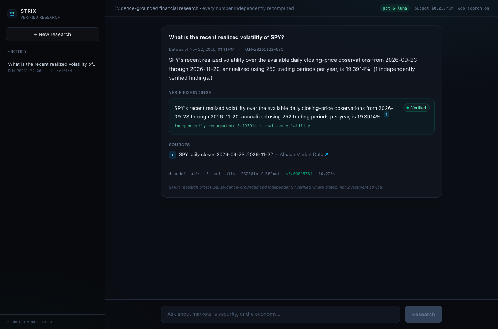
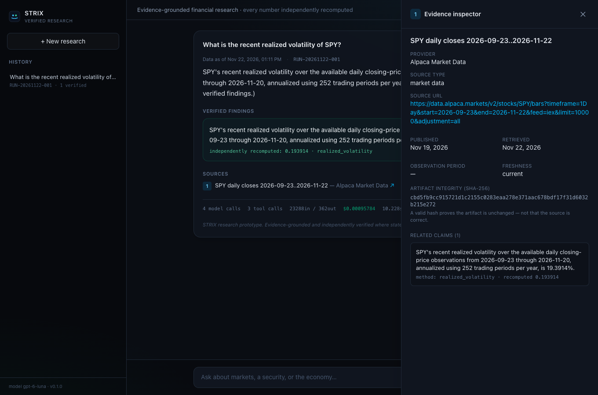

# STRIX
## Structured Traceability, Retrieval, and Intelligence eXtraction

It sounds like a serious intelligence system, and Strix is associated with owls—observation, knowledge, and seeing what others miss.

STRIX is an evidence-grounded research pipeline prototype. Every number it
reports traces through a typed, hash-verified lineage:

```
SourceArtifact -> SourceFact -> CalculationResult -> Evidence -> Claim -> Verified report
```

An interactive CLI turns a research question into a validated specification,
extracts facts from a preserved source artifact, runs deterministic Decimal
calculations, builds citable evidence, constructs a structured claim, verifies
every citation and number, renders a terminal report, and persists a fully
replayable run directory.

**What STRIX is not:** it is a research and decision-support prototype — not an
automated trading system and not a source of investment advice. Its original v1
pipeline reasoner is deterministic Python (no LLM); STRIX now *also* includes an
evidence-grounded **OpenAI research agent** (see below) in which the model only
proposes claims an independent verifier must confirm — the model can never mark
its own output verified.

## Data sources

| Ticker | Source | Network |
|---|---|---|
| `DEMO` | Bundled synthetic fixture (fictional "Demonstration Company") | None — fully offline |
| Any real ticker (e.g. `AAPL`) | SEC EDGAR company facts (XBRL, as filed) | Fetch time only |

No API keys or credentials are required. SEC EDGAR is a public API; STRIX
sends the fair-access `User-Agent` header. The fetched raw bytes are preserved
inside each run directory, so **replay never touches the network** — even for
real-data runs.

The DEMO fixture is clearly synthetic and must never be presented as real
financial data.

## Installation

Requires Python 3.11+.

```bash
cd /Users/blkpvnthr/STRIX     # or wherever you cloned the repository
python3 -m venv .venv
source .venv/bin/activate
python -m pip install --upgrade pip
python -m pip install -e ".[dev]"
strix --help
```

## Usage

Interactive research run:

```bash
strix   # Press Enter for offline DEMO, or enter AAPL for live SEC data
```

(`python -m strix` is equivalent.)

```
Ticker [DEMO]:
> 
Research question [Is operating profitability improving?]:
> 
As-of date [2026-08-08]:
> 
...
Finding

Operating margin increased from 8.4% to 10.1%, an
improvement of 1.7 percentage points.
[EV-..., EV-..., EV-...]

Verification: Passed
Research run: RUN-20260808-001

Synthetic demonstration data — not investment advice.
```

Replay a preserved run (recomputes everything and compares hashes):

```bash
strix replay RUN-20260808-001
```

Run artifacts live in `./research_runs/` by default (gitignored). Override
with `--state-dir PATH` or the `STRIX_STATE_DIR` environment variable.

## How verification works

- All financial math uses `Decimal` — binary floating point is rejected at
  every boundary (models, canonical serialization, JSON parsing).
- Facts, calculations, evidence, and claims carry content-derived IDs
  (`FACT-`, `CALC-`, `EV-`, `CL-` + SHA-256 prefix): identical inputs always
  produce identical IDs.
- The deterministic verifier rejects claims with unknown or unverified
  evidence, wrong subjects, values not knowable by the as-of date, numeric or
  unit mismatches, broken lineage, or a direction that contradicts the
  calculated change. Report prose is re-rendered from verified structured
  values, so the sentence cannot silently disagree with the numbers.
- A hash proves content identity and integrity — not that the content is true.

## The reasoning boundary

`strix.reasoning.base.Reasoner` is a protocol that receives only the research
spec and the curated evidence bundle. The current implementation
(`DeterministicDemoReasoner`) is fixed, auditable Python — **not an LLM**. A
future schema-constrained LLM adapter will plug in behind the same protocol
and the same verifier; no reasoner can bypass verification, calculate
authoritative ratios, or override a failed check.

---

## OpenAI Research Agent (`strix ask` + web app)

> **v0.2.0** (release candidate) — see [`CHANGELOG.md`](CHANGELOG.md), the
> [release notes](docs/releases/v0.2.0.md), the
> [release audit](docs/releases/v0.2.0-audit.md), and the
> [research benchmark](docs/releases/v0.2.0-benchmark.md).


STRIX now includes an **evidence-grounded OpenAI research agent** that answers
natural-language questions about markets, securities, and economic conditions —
and **independently recomputes every quantitative claim** before presenting it.
It plugs in behind the same trust boundary described above: the language model
proposes candidate claims, and a verifier the model cannot influence decides
what is true.



### Model and configuration

The agent uses **GPT-6 Luna** (`gpt-6-luna`) — the cheapest of the permitted
models (`gpt-6-luna`, `gpt-6.1-terra`, `gpt-6.1-sol`, `gpt-6-astra`) at
`$0.10 / $0.01 / $0.50` per 1M input / cached-input / output tokens. The agent
never silently escalates to a costlier model; an unavailable model is a
configuration error.

Configuration is read from `.env` (see `.env.example`). The key may be set as
either `OPENAI_API_KEY` or `OPEN_AI_API_KEY`; it is held as a `SecretStr` and is
never logged, persisted, committed, or sent to the browser. Every limit below is
enforced in code:

```dotenv
STRIX_LLM_MODEL=gpt-6-luna
STRIX_LLM_REASONING_EFFORT=low
STRIX_AGENT_MAX_MODEL_CALLS=8
STRIX_AGENT_MAX_TOOL_CALLS=16
STRIX_AGENT_MAX_RESEARCH_SECONDS=120
STRIX_AGENT_MAX_COST_USD=0.05
STRIX_OPENAI_WEB_SEARCH_ENABLED=true
```

### Startup

```bash
python -m pip install -e ".[dev,web]"      # installs openai + FastAPI stack
python -m strix.agent.diagnostics          # redacted config + live connectivity check

# CLI — ask a question and get a cited, verified answer
strix ask "What is the recent realized volatility of SPY?"
strix replay RUN-YYYYMMDD-NNN              # deterministically re-verify a run

# Web app (single command serves API + built UI at http://127.0.0.1:8000)
( cd web && npm install && npm run build )
strix-web                                  # or: python -m strix.webapi.app
```

For live frontend development with hot reload, run `strix-web` (port 8000) and,
in `web/`, `npm run dev` (port 5173, proxies `/api` to the backend).

### Research tools and data sources

| Tool | Source | Credentials |
|---|---|---|
| `get_historical_prices`, `get_market_quote` | Alpaca Market Data (live) | `ALPACA_API_KEY_ID` / `ALPACA_API_SECRET_KEY` |
| `get_sec_financials` | SEC EDGAR company facts | none (public) |
| `get_economic_series` | FRED/BLS | none configured → returns structured *unavailable* |
| `search_current_information` | OpenAI hosted web search | the OpenAI key |
| `calculate` | Deterministic calculators (return, drawdown, realized vol, moving average, relative performance, correlation) | — |
| `submit_claim` | Records a **candidate** claim (status `pending`); cannot set a verdict | — |

Connectors return real preserved data or a structured *unavailable* result —
they never fabricate values.

### Evidence-verification lifecycle

```
question -> bounded tool loop (fetch -> calculate -> submit_claim)
         -> preserve evidence (SHA-256) + observation series
         -> INDEPENDENT verifier recomputes every number
         -> VERIFIED | CONTRADICTED | INSUFFICIENT_EVIDENCE | UNVERIFIABLE | STALE
         -> deterministic, fail-closed answer -> persisted + replayable
```

- A quantitative claim is **VERIFIED** only if the verifier reproduces its value
  from the preserved observations within tolerance. A wrong number is
  **CONTRADICTED** and never shown as fact.
- Textual claims get a bounded *attribution* check against preserved excerpts —
  that verifies the source was retrieved and contains the text, **not** that the
  statement is objectively true. Interpretations, hypotheses, and forecasts are
  always **UNVERIFIABLE** by type.
- A citation alone never qualifies an assertion: each verified claim's evidence
  must resolve, and quantitative claims must carry an independent recomputation.
- Retrieved documents and web content are treated as **untrusted data**, never
  as instructions.

Every citation opens an **evidence inspector** (provider, source URL, published
and retrieved dates, freshness, SHA-256 integrity, related claims):



### Cost, security, and verification limitations

- **Cost** is accounted per run (input / cached / output / reasoning tokens
  without double-counting, model + tool calls, USD) against a versioned pricing
  table, and enforced against `STRIX_AGENT_MAX_COST_USD`. The eight demonstration
  questions cost **~$0.015 total**; a typical run is a fraction of a cent.
- **Security**: the API key never reaches the frontend; `.env` is gitignored;
  prompt-injection from sources is defended in the system prompt and tests. The
  local web API binds `127.0.0.1` with localhost-only CORS and has **no
  authentication** — it is a single-user local tool; do not expose the port.
- **Verification is bounded and honest**: numerical recomputation and source
  integrity are strong; general natural-language entailment is *not* attempted.
  Without a FRED/BLS key, economic questions (CPI, Treasury yields) rely on web
  search and are reported as attribution-only or insufficient evidence rather
  than fabricated. Cryptographic artifact integrity is kept distinct from factual
  verification.

## Development

```bash
python -m pytest          # test suite (offline; sockets are blocked)
python -m ruff format .   # formatting
python -m ruff check .    # linting
python -m mypy            # strict type checking
```

Documentation (MkDocs Material):

```bash
python -m pip install -r requirements-docs.txt
mkdocs serve              # http://127.0.0.1:8000
```

## Current limitations

- One research question type: operating-margin change between two
  year-over-year quarters.
- EDGAR quarter labels use the calendar quarter of the period end date, an
  approximation for off-calendar fiscal years.
- Restated figures: STRIX deliberately uses the earliest-filed value (the
  first-known figure) for point-in-time honesty.
- The deterministic v1 pipeline (`strix`, no LLM) answers one question type:
  operating-margin change between two year-over-year quarters.
- The OpenAI research agent (`strix ask` / web app) verifies numerical claims it
  can recompute from preserved observations (returns, drawdown, realized
  volatility, moving average, relative performance, correlation); questions
  needing data sources not configured (e.g. FRED economic series) return honest
  insufficient-evidence results rather than fabricated numbers.
- No database or object storage, portfolio integration, forecasting, or trading
  — see the roadmap in `docs/development/roadmap.md`.

Future BLKPVNTHR.OS route name: `/strix`.

