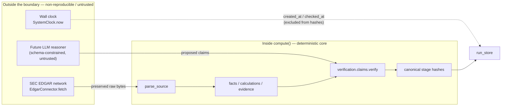

# The deterministic boundary

STRIX draws a hard line around a single pure function, `pipeline.compute`.
Everything reproducible about a run happens inside it; everything
non-reproducible — the network and the wall clock — stays outside and is fed in
as preserved inputs.

**The guarantee.** Given the same `ResearchSpec` and the same preserved raw
source bytes (and the same reasoner), `compute()` produces byte-identical
facts, calculations, evidence, and claims, and therefore identical stage
hashes. This is exactly what [replay](usage/replay.md) checks: it recomputes
from `spec.json` and the preserved `raw/` bytes and compares every hash against
the manifest.

!!! warning "A hash proves integrity, not truth"
    Matching hashes prove that content is identical and untampered. They do not
    prove that the underlying figures are factually correct — only that STRIX
    processed the same inputs the same way. Provenance and point-in-time
    correctness are separate concerns covered in [Provenance](provenance.md).

## What sits where

- **The network** is touched only by `EdgarConnector.fetch`, before `compute()`
  runs. The bytes it returns are preserved verbatim in the run directory, so
  every later parse — including replay — is offline and byte-identical.
- **The wall clock** (`SystemClock.now`) supplies `created_at` and `checked_at`.
  These are stamped onto the manifest and verification result but are excluded
  from every deterministic hash and from replay comparison.
- **A future LLM reasoner** would live outside the boundary too. Its output is
  treated as an untrusted proposal that the deterministic verifier must accept
  before anything is published — see [LLM boundary](llm-boundary.md).

## How determinism is achieved

### Canonical JSON (`canonical.py`)

Every hash and every content-derived ID serializes through `to_jsonable` and
`canonical_bytes`, which enforce one byte-level form for identical logical
content:

- object keys sorted, separators compact (`","`, `":"`), UTF-8, `ensure_ascii`
  off;
- `Decimal` encoded as an exact, representation-normalized plain string
  (trailing zeros stripped, exponents expanded, all zeros collapse to `"0"`), so
  `Decimal("84000000.00")` and `Decimal("8.4E+7")` hash identically;
- timezone-aware datetimes normalized to UTC ISO 8601; `date` as ISO 8601;
- enums encoded by value;
- `float` rejected everywhere it could appear.

### Decimal-only arithmetic

Binary floating point is refused at every entry point: the model layer
(`_reject_float` on `DecimalValue`), canonical serialization (`to_jsonable`
raises on `float`), the demo fixture parser (`json.loads(..., parse_float=...)`
raises), and the EDGAR parser (`parse_float=Decimal`). A stray `float` would
make results platform-dependent, so it is never allowed to enter.

### Local decimal contexts

`analytics/profitability.py` and `formatting.py` do all arithmetic inside
`with localcontext()` (precision 34, `ROUND_HALF_EVEN`). The global decimal
context is never mutated, so results do not depend on ambient process state.
Margins quantize to six decimals, percentage-point changes to four, and display
values to one — each a fixed, explicit quantum.

### Content-derived identifiers

`ART-`, `FACT-`, `CALC-`, `EV-`, and `CL-` IDs are `PREFIX-sha256(canonical
payload)[:12]`. The payload contains only reproducible fields — never the
object's own ID, a wall-clock timestamp, or an absolute path. Identical content
therefore always yields the same ID, and a changed value changes the ID.

### Wall-clock and presentation exclusion

The stage hashes and replay comparison deliberately exclude:

- `run_id` (identifies an execution, not content);
- `created_at` and `checked_at` (wall clock);
- the run directory path and absolute paths generally (`local_path` is
  relative);
- `Evidence.display_value` (presentation-only — `evidence_hash` dumps each
  record with `exclude={"display_value"}`).

`known_at` is **not** excluded: it comes from the fixture or filing and is part
of the content, so it is hashed and compared.

### Role-ordered lists

Where order carries meaning, it is fixed by role rather than left to chance:
`historical_periods` is `(previous, current)`; `input_fact_ids` is
`(numerator, denominator)`; a change calculation's `input_calculation_ids` is
`(current, previous)`; the claim cites evidence in `(previous, current, change)`
order. The same inputs always produce the same ordering.

### Sorted stage hashes

Where order is *not* meaningful, the hash removes it. `facts_hash`,
`calculations_hash`, `evidence_hash`, and `claims_hash` each sort their records
by ID before hashing (`fact_id`, `calculation_id`, `evidence_id`, `claim_id`
respectively). In-memory ordering can differ without changing the hash, so the
hash reflects the *set* of content, not an incidental sequence.

## Replay uses the same function

`replay_run` does not trust the stored calculation files as if they were freshly
computed. It re-runs the identical `compute()` over the preserved spec and raw
bytes with a fixed `checked_at` constant, then checks two independent
properties per stage:

- **integrity** — the files still in the run directory hash to what the manifest
  recorded (detects tampering with stored files);
- **reproducibility** — recomputing from the preserved inputs yields the same
  hashes (detects nondeterminism or contract drift).

Both must agree with the manifest for a stage to be reported as `matched`. The
[Replay](usage/replay.md) page shows the seven-row table this produces.
