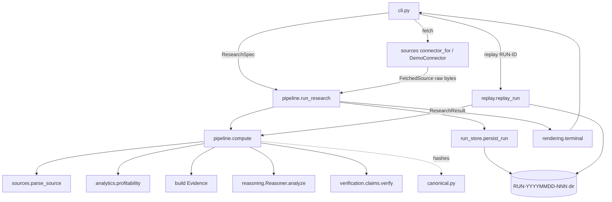

# Project structure

STRIX is a small, layered Python package. Every module has one job, and the
boundaries between jobs are enforced by what each module is allowed to import
and do — not merely by convention. This page maps the real source tree to
those responsibilities and lists the layering rules the code actually holds
to.

!!! warning "Synthetic demonstration data"
    The bundled `DEMO` ticker resolves to a fictional company in a committed
    fixture. Any output derived from it is illustrative only and is not
    investment advice.

## Source tree

The package lives under `src/strix/`; the test suite lives under `tests/`.
The tree below is the real layout.

```text
src/strix/__init__.py
src/strix/__main__.py
src/strix/analytics/__init__.py
src/strix/analytics/profitability.py
src/strix/canonical.py
src/strix/cli.py
src/strix/errors.py
src/strix/fixtures/demo-company-facts.json
src/strix/formatting.py
src/strix/models.py
src/strix/pipeline.py
src/strix/reasoning/__init__.py
src/strix/reasoning/base.py
src/strix/reasoning/deterministic_demo.py
src/strix/rendering/__init__.py
src/strix/rendering/terminal.py
src/strix/replay.py
src/strix/run_store.py
src/strix/sources/__init__.py
src/strix/sources/base.py
src/strix/sources/demo.py
src/strix/sources/edgar.py
src/strix/verification/__init__.py
src/strix/verification/claims.py
tests/__init__.py
tests/conftest.py
tests/data/edgar-company-tickers-sample.json
tests/data/edgar-companyfacts-sample.json
tests/test_canonical.py
tests/test_cli.py
tests/test_edgar.py
tests/test_entrypoints.py
tests/test_evidence.py
tests/test_formatting.py
tests/test_profitability.py
tests/test_replay.py
tests/test_run_store.py
tests/test_verification.py
```

Alongside the package, the repository root holds `pyproject.toml` (packaging,
tool config, and the `strix` console script), `README.md`, `mkdocs.yml` and
`docs/` (this site), and `requirements-docs.txt`.

## Per-module responsibilities

| Module | Responsibility |
| --- | --- |
| `__init__.py` | Declares `__version__` and `PIPELINE_VERSION` (both `0.1.0`). `PIPELINE_VERSION` is stamped into every `ResearchSpec` and `RunManifest` so replay can detect contract drift. |
| `__main__.py` | The `python -m strix` entry point; it just calls `cli.main`. |
| `models.py` | All frozen, closed-schema Pydantic domain models and the bounded enums (`SourceType`, `Concept`, `Unit`, `Metric`, `ClaimType`, `FailureCode`, …). Defines the lineage contract `SourceArtifact -> SourceFact -> CalculationResult -> Evidence -> Claim`. Rejects `float` on every `Decimal` field. |
| `errors.py` | The typed exception hierarchy rooted at `StrixError`. The CLI surfaces only `str(exc)` for these, never a traceback. |
| `canonical.py` | Canonical JSON serialization and SHA-256 hashing. The **only** place hashes and content-derived IDs are produced: `canonical_hash`, `sha256_hex`, `make_id`, plus `encode_decimal`/`pretty_json_bytes`. Forbids `float` everywhere. |
| `formatting.py` | Pure display formatting and prose rendering (`display_percent`, `display_percentage_points`, `direction_from_change`, `render_statement`). No I/O, no financial calculation beyond display scaling. |
| `analytics/profitability.py` | The **only** module that computes authoritative financial values: `operating_margin` (ratio) and `operating_margin_change_pp` (percentage points), with exact `Decimal` arithmetic and `CALCULATION_VERSION`. |
| `sources/base.py` | The connector contract: `NormalizedFact`, `SourceDocument`, `FetchedSource`, and the `SourceConnector` protocol (`fetch` only). |
| `sources/__init__.py` | The deterministic `parse_source` dispatcher and `connector_for` selector. |
| `sources/demo.py` | The fully offline synthetic-fixture connector and its strict parser (`parse_demo_fixture`). |
| `sources/edgar.py` | The SEC EDGAR company-facts connector. The **only** module that touches the network, and only inside `EdgarConnector.fetch` / `fetch_url`. Parsing (`parse_companyfacts`) is pure. |
| `pipeline.py` | Orchestration. `compute` is the deterministic core shared by run and replay; `run_research` fetches, computes, and persists a run. Owns the per-stage hash helpers. |
| `reasoning/base.py` | The `Reasoner` protocol — the seam where constrained reasoning plugs in. |
| `reasoning/deterministic_demo.py` | `DeterministicDemoReasoner`: fixed, auditable Python (not an LLM) that assembles one profitability claim from evidence. |
| `verification/claims.py` | The deterministic verifier: evidence-lineage pass and claim-check pass. Produces a `VerificationResult` and updated statuses. |
| `run_store.py` | Atomic, replayable persistence: staging directory, `os.rename` commit, run-ID sequencing and validation, artifact-name safety, state-dir resolution. |
| `replay.py` | Re-executes `compute` from preserved inputs and compares stored + recomputed hashes stage by stage. |
| `rendering/terminal.py` | Pure terminal text: banner, progress rows, finding block, failure list, `report.txt` body, and the replay table. Computes nothing. |
| `cli.py` | The interactive CLI and the `replay` subcommand. Presentation and input only. |

## Call flow



The reasoner sits between evidence construction and verification, and it
receives only `(spec, evidence)` — see
[Adding reasoners](adding-reasoners.md).

## Layering rules the code enforces

These are not style guidelines; each is expressed in the modules themselves
and checked by the test suite.

### The CLI computes nothing

`cli.py` is documented and built as "a presentation and input layer only …
It performs no financial calculation, builds no evidence, and verifies
nothing." It imports `run_research`, `replay_run`, the terminal renderer, and
the source connectors — never `analytics` or `verification`. Everything
deterministic happens behind `run_research` / `replay_run`.

### The renderer computes nothing

`rendering/terminal.py` "may not calculate financial metrics, create or
mutate evidence and claims, verify anything, read fixtures, touch the
network, or modify saved run artifacts." Its functions take already-computed
models (`ResearchReport`, `VerificationResult`, `ReplayOutcome`) and return
strings.

### Financial values are calculated only in `analytics`

`pipeline.compute` builds facts, then calls `operating_margin` and
`operating_margin_change_pp` from `analytics.profitability` to produce every
authoritative number. No other module divides revenue into income. The
verifier deliberately performs **no** new financial calculation; its only
independent recomputations are the direction sign and the prose re-rendering.

### The reasoner sees only `(spec, evidence)`

`reasoning/base.py` defines `analyze(self, spec, evidence) -> list[Claim]`.
The reasoner "must not read files, environment variables, the network,
credentials, or terminal state, and it must not compute new authoritative
financial values." `tests/test_cli.py::TestReasonerIsolation` runs the demo
reasoner with `builtins.open` and `builtins.input` monkeypatched to raise, to
prove it.

### Only `canonical.py` feeds hashes and IDs

Every content-derived identifier (`ART-`, `FACT-`, `CALC-`, `EV-`, `CL-`) and
every stage hash flows through `canonical.make_id` / `canonical.canonical_hash`
/ `canonical.sha256_hex`. The rules there are strict by design: sorted keys,
compact separators, `Decimal` encoded as normalized plain strings, timezone-
aware datetimes normalized to UTC, and `float` forbidden outright. Because
hashing has one implementation, "identical logical content" always means
"identical bytes."

### Network access lives only in `sources/edgar.py`

The only outbound network calls are `urllib` requests inside
`edgar.fetch_url`, reached only from `EdgarConnector.fetch`. `parse_source`
and both parsers (`parse_demo_fixture`, `parse_companyfacts`) are pure
functions of preserved bytes, so **replay is always offline**. The test suite
installs a suite-wide socket guard (`tests/conftest.py`) that fails any test
that tries to open a socket.

### Wall-clock time never enters deterministic content

`created_at` and `checked_at` are stamped from an injectable `Clock` and are
excluded from every stage hash and from replay comparison. `known_at` (a
fixture timestamp or an SEC `filed` date) is deterministic content and **is**
hashed. See [Provenance](../provenance.md) and
[Replay](../usage/replay.md).
