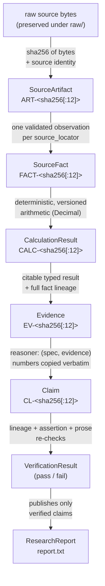

# Evidence Model

STRIX reports numbers only when a typed chain of custody connects each number
back to preserved source bytes. That chain is the **evidence model**: a small
set of frozen, content-addressed records where every stage cites the stage
before it, and every content-derived identifier is a hash of the fields that
define the record — nothing else.

This page documents the lineage contract exactly as it is implemented in
`src/strix/models.py`, `src/strix/canonical.py`, `src/strix/pipeline.py`,
`src/strix/analytics/profitability.py`, and
`src/strix/reasoning/deterministic_demo.py`.

## The lineage graph



The module boundaries that produce each hop:

| Hop | Produced by | Function |
| --- | --- | --- |
| `SourceArtifact` | `strix.pipeline` | `compute` (via `make_id("ART", …)`) |
| `SourceFact` | `strix.pipeline` | `_build_facts` |
| `CalculationResult` | `strix.analytics.profitability` | `operating_margin`, `operating_margin_change_pp` |
| `Evidence` | `strix.pipeline` | `_build_evidence` |
| `Claim` | `strix.reasoning.deterministic_demo` | `DeterministicDemoReasoner.analyze` |
| `VerificationResult` | `strix.verification.claims` | `verify` |
| `ResearchReport` | `strix.pipeline` | `run_research` → `build_report` |

## Canonical serialization: the byte-exact foundation

Every hash and every content-derived identifier in STRIX flows through
`strix.canonical`. The rules are deliberately strict so that identical logical
content always produces identical bytes:

- **Sorted keys, compact separators, UTF-8.** `canonical_bytes` calls
  `json.dumps(..., sort_keys=True, separators=(",", ":"), ensure_ascii=False)`
  and encodes to UTF-8.
- **`float` is forbidden everywhere.** `to_jsonable` raises `TypeError` on any
  `float`. Monetary and ratio values are `Decimal`; the domain models reject
  `float` a second time through the `DecimalValue` validator in `models.py`.
- **`Decimal` is representation-normalized.** `encode_decimal` emits an exact
  plain-decimal string: trailing zeros are stripped, scientific notation is
  expanded, and every zero collapses to `"0"`. Therefore
  `Decimal("84000000.00")`, `Decimal("8.4E+7")`, and `Decimal("84000000")`
  all serialize to `"84000000"` and hash identically.
- **Datetimes are tz-aware UTC ISO 8601.** A naive `datetime` raises; an aware
  one is normalized with `astimezone(UTC)`. `date` values use ISO dates.
- **Enums are encoded by value** (`SourceType.SYNTHETIC_FIXTURE` →
  `"synthetic_fixture"`).

`canonical_hash(obj)` is `sha256(canonical_bytes(obj)).hexdigest()`.
`make_id(prefix, payload)` returns `"{prefix}-{canonical_hash(payload)[:12]}"` —
a 12-hex-char (48-bit) prefix of the SHA-256 digest.

!!! note "Stable IDs"
    Because IDs are pure functions of canonical bytes, identical canonical
    inputs always produce identical IDs. Two runs over the same fixture on
    different days, different machines, or different clocks yield the same
    `ART-`, `FACT-`, `CALC-`, `EV-`, and `CL-` identifiers. This is what makes
    replay a byte-for-byte comparison rather than a fuzzy one.

## What feeds each ID — and what is deliberately excluded

The guiding rule (`make_id` docstring): *a payload must contain only
reproducible fields — never the object's own id, wall-clock timestamps, or
absolute filesystem paths.* Below, each ID's payload is taken verbatim from the
`make_id` call sites.

### `ART-` — SourceArtifact

Call site: `compute` in `pipeline.py`.

| Included in the ID payload | Source |
| --- | --- |
| `source_type` | `synthetic_fixture` or `sec_edgar_companyfacts` |
| `source_name` | plain file name, e.g. `demo-company-facts.json` |
| `source_version` | fixture version, or EDGAR `revenue_tag@filed-through-<date>` |
| `content_hash` | `sha256_hex(raw)` of the exact preserved bytes |

**Excluded:** `artifact_id` (its own id), `known_at`, `local_path` (a
run-relative path, never absolute), and `byte_size`. The artifact identity is
anchored to the raw bytes' SHA-256; two runs that fetched byte-identical source
data produce the same `ART-` id.

### `FACT-` — SourceFact

Call site: `_build_facts` in `pipeline.py`.

| Included | Notes |
| --- | --- |
| `artifact_id` | the `ART-` id above (binds the fact to its artifact) |
| `subject_id` | e.g. `demo-company-000001` |
| `concept` | `revenue` or `operating_income` (enum by value) |
| `value` | `Decimal`, canonically encoded |
| `unit` | `USD` |
| `observation_period` | e.g. `2025-Q2` |
| `known_at` | fixture timestamp / SEC filed date |
| `source_locator` | JSON pointer into the raw artifact |

**Excluded:** `fact_id` (own id) and `validation_status`. Status is excluded so
that a fact's identity does not change if its validation outcome were ever to
change; the id names *the observation*, not a verdict about it.

### `CALC-` — CalculationResult

Call sites: `operating_margin` and `operating_margin_change_pp` in
`analytics/profitability.py`.

`operating_margin` payload: `calculation_name`, `calculation_version`,
`subject_id`, `input_fact_ids` (role-ordered `[operating_income, revenue]`),
`value`, `unit` (`ratio`), `observation_period`.

`operating_margin_change_pp` payload additionally carries
`input_calculation_ids` (role-ordered `[current, previous]`) and uses
`unit = percentage_points` with `observation_period` like `2025-Q2..2026-Q2`.

**Excluded:** `calculation_id` (own id). The `calculation_version` **is**
included — see [Calculation versioning](#calculation-versioning).

### `EV-` — Evidence

Call site: `_build_evidence` in `pipeline.py`.

| Included | Notes |
| --- | --- |
| `calculation_id` | the `CALC-` this evidence rests on |
| `subject_id` | |
| `evidence_type` | `calculation` |
| `metric` | `operating_margin` or `operating_margin_change_pp` |
| `value` | `Decimal` |
| `unit` | `ratio` or `percentage_points` |
| `observation_period` | |
| `known_at` | `max(known_at)` over the input facts |
| `source_fact_ids` | the `CALC`'s `input_fact_ids`, role-ordered |

**Excluded:** `evidence_id` (own id), `display_value` (presentation-only), and
`status`. See [Evidence status lifecycle](#evidence-status-lifecycle) for why
`status` is excluded.

### `CL-` — Claim

Call site: `DeterministicDemoReasoner.analyze` in `deterministic_demo.py`.

| Included | Notes |
| --- | --- |
| `subject_id` | |
| `claim_type` | `profitability_change` |
| `direction` | `increased` / `decreased` / `unchanged` |
| `evidence_ids` | role-ordered `[previous, current, change]` |
| `numeric_assertions` | each: `{metric, asserted_value, unit, evidence_id}` |

**Excluded:** `claim_id` (own id), `status`, and — notably — `statement`. The
prose is excluded because it is a **pure function** of `direction` and the
cited margin values (rendered by `formatting.render_statement`); the claim's
identity is its structured content, and the verifier independently re-derives
the sentence from that content (see below). Two runs that produce the same
structured claim get the same `CL-` id regardless of any cosmetic wording.

## Worked example (the DEMO run)

From the ground-truth artifacts of `RUN-20260809-001` over the bundled fixture:

`facts.json` (abridged):

```json
[
  {
    "concept": "revenue",
    "fact_id": "FACT-fde4b197a83c",
    "known_at": "2025-07-15T00:00:00+00:00",
    "observation_period": "2025-Q2",
    "source_artifact_id": "ART-f2b516c96247",
    "source_locator": "/periods/0/facts/0",
    "subject_id": "demo-company-000001",
    "unit": "USD",
    "validation_status": "valid",
    "value": "1000000000"
  },
  {
    "concept": "operating_income",
    "fact_id": "FACT-59fc3cdc0b33",
    "...": "...",
    "source_locator": "/periods/0/facts/1",
    "value": "84000000"
  }
]
```

`calculations.json` (abridged) — note `input_calculation_ids` linking the
change to its two upstream margins:

```json
[
  {
    "calculation_id": "CALC-cf3c3f6a4f26",
    "calculation_name": "operating_margin",
    "calculation_version": "1.0.0",
    "input_fact_ids": ["FACT-59fc3cdc0b33", "FACT-fde4b197a83c"],
    "observation_period": "2025-Q2",
    "unit": "ratio",
    "value": "0.084"
  },
  {
    "calculation_id": "CALC-bb36572ac2e1",
    "calculation_name": "operating_margin_change_pp",
    "input_calculation_ids": ["CALC-fb3e8afffc03", "CALC-cf3c3f6a4f26"],
    "input_fact_ids": ["FACT-9cff5a7d197e", "FACT-984d1189dc7a", "FACT-59fc3cdc0b33", "FACT-fde4b197a83c"],
    "observation_period": "2025-Q2..2026-Q2",
    "unit": "percentage_points",
    "value": "1.7"
  }
]
```

`evidence.json` (abridged) — carries `display_value` and `status` (both
excluded from the `EV-` id):

```json
{
  "calculation_id": "CALC-cf3c3f6a4f26",
  "display_value": "8.4%",
  "evidence_id": "EV-9d33ded8a427",
  "known_at": "2025-07-15T00:00:00+00:00",
  "metric": "operating_margin",
  "source_fact_ids": ["FACT-59fc3cdc0b33", "FACT-fde4b197a83c"],
  "status": "verified",
  "unit": "ratio",
  "value": "0.084"
}
```

`claims.json` (abridged) — every number is a `numeric_assertion` bound to the
evidence that must support it:

```json
{
  "claim_id": "CL-03d483aef9c0",
  "claim_type": "profitability_change",
  "direction": "increased",
  "evidence_ids": ["EV-9d33ded8a427", "EV-649d8a693225", "EV-d1e9faaf6787"],
  "numeric_assertions": [
    {"asserted_value": "0.084", "evidence_id": "EV-9d33ded8a427", "metric": "operating_margin", "unit": "ratio"},
    {"asserted_value": "0.101", "evidence_id": "EV-649d8a693225", "metric": "operating_margin", "unit": "ratio"},
    {"asserted_value": "1.7",   "evidence_id": "EV-d1e9faaf6787", "metric": "operating_margin_change_pp", "unit": "percentage_points"}
  ],
  "statement": "Operating margin increased from 8.4% to 10.1%, an improvement of 1.7 percentage points.",
  "status": "verified"
}
```

## Calculation versioning

Every `CalculationResult` carries a `calculation_version` (currently
`"1.0.0"`, defined as `CALCULATION_VERSION` in
`analytics/profitability.py`). Because it is part of the `CALC-` id payload,
changing the calculation contract changes the id — and therefore the downstream
`EV-` and `CL-` ids too. The manifest records the versions used per run:

```json
"calculation_versions": {
  "operating_margin": "1.0.0",
  "operating_margin_change_pp": "1.0.0"
}
```

This makes a change in calculation logic a visible, replay-detectable event
rather than a silent one.

## Observation periods

The `observation_period` string is part of the identity of facts,
calculations, evidence, and (through assertions) claims. Single-period records
use a `YYYY-QN` label (`2025-Q2`). The margin-change calculation spans two and
uses a range label built as `f"{previous}..{current}"` — for the DEMO run,
`2025-Q2..2026-Q2`. For EDGAR sources the `YYYY-QN` label is derived from the
period's calendar-quarter end date and is display naming only; the true pairing
is by exact end date (see [Provenance](provenance.md)).

## `known_at` semantics — deterministic content, not wall clock

`known_at` records **when a value became knowable**, and it is deliberately
part of hashed content:

- **Demo fixture:** the period's `known_at` timestamp from the JSON
  (`2025-07-15T00:00:00+00:00`).
- **EDGAR:** the SEC `filed` date of the underlying fact, at UTC midnight.
- **Evidence:** the `max` of the `known_at` values of its input facts — a
  calculation is only knowable once its latest input is.

This is distinct from wall-clock timestamps such as `created_at` (manifest) and
`checked_at` (verification), which are **excluded** from every hash and from
replay comparison. `known_at` drives the verifier's point-in-time gate: any
evidence whose `known_at` date is after the spec's `as_of_date` is rejected
with `evidence_after_as_of`.

## Evidence status lifecycle

`Evidence.status` moves through:

```
unverified  ->  verified   (lineage checks pass)
            ->  rejected   (any lineage check fails)
```

Evidence is created `unverified` in `_build_evidence`. The verifier
(`verification/claims.py`) re-resolves each evidence record through
`Evidence -> CalculationResult -> SourceFact -> SourceArtifact`, confirms its
value/unit match its calculation exactly, and produces a copy with
`status = verified` or `rejected`.

**Why `status` is excluded from the `EV-` id:** the id is computed at creation
time, before verification runs, and must be stable across the whole lifecycle.
A record's identity names *the evidentiary content*; whether it passed
verification is a separate, recomputable verdict. If status were in the id,
verifying evidence would change its id and break every downstream citation. The
stage hash reflects this too: `evidence_hash` includes `status` (the on-disk
`verified` state is content worth integrity-checking) but always excludes
`display_value`.

## Numeric assertions bind claim numbers to evidence

A `Claim` may not state a bare number. Each figure in the claim is a
`NumericAssertion` — `{metric, asserted_value, unit, evidence_id}` — that names
the exact `Evidence` that must support it. The demo reasoner copies every
`asserted_value` **verbatim** from cited evidence; it invents no authoritative
values. The verifier then enforces:

- `assertion_value_mismatch` — the asserted value must equal the evidence value.
- `assertion_unit_mismatch` — the asserted unit must equal the evidence unit.
- `assertion_evidence_not_cited` — an assertion's `evidence_id` must also appear
  in the claim's `evidence_ids`, so it cannot smuggle in evidence that skips the
  subject / as-of / verified-status gates.
- `missing_assertion` — the previous margin, current margin, and change must each
  be asserted; a claim cannot dodge the value checks by omitting an assertion.

## Claim-to-evidence citation rules

For a `profitability_change` claim, the verifier requires that:

- every cited evidence id exists, belongs to the claim's subject **and** the
  spec's company, was knowable by the as-of date, and is `verified`;
- the complete comparison set is cited — previous-period margin, current-period
  margin, and the change (`missing_comparison_evidence` otherwise);
- the structured `direction` matches the sign of the change evidence
  (`direction_mismatch` otherwise); and
- the `statement` prose exactly equals the deterministic re-rendering of the
  structured values via `render_statement` (`statement_mismatch` otherwise).

Because the prose is re-derived rather than parsed, displayed text can never
silently disagree with the verified numbers. The full failure-code catalogue is
in [Security](security.md#failure-codes) and the verifier reference.

## Reproducibility guarantees

- **Deterministic identity.** Identical canonical inputs produce identical
  `ART-/FACT-/CALC-/EV-/CL-` ids and identical stage hashes, independent of
  machine, wall clock, or run id.
- **Complete lineage.** Every reported number resolves through
  `Evidence -> CalculationResult -> SourceFact -> SourceArtifact -> raw bytes`,
  and the verifier rejects any evidence with a broken link
  (`incomplete_lineage`, `unknown_calculation`, `missing_source_fact`,
  `artifact_mismatch`).
- **No hidden inputs.** Wall-clock timestamps and local paths never enter
  hashed content, so they cannot perturb identity or replay.
- **Prose cannot drift.** The claim sentence is a function of verified numbers
  and is re-checked, not trusted.

## Limitations

- IDs use a 48-bit (12 hex char) hash prefix. That is ample to distinguish the
  records within a run, but it is a truncation, not the full digest.
- The evidence model proves that a number was *computed correctly from the
  preserved source*. It says nothing about whether the source itself is
  correct, complete, or representative.
- The reasoning stage is a fixed, auditable Python demo, not an LLM. The typed
  contract is what a future constrained reasoner would have to satisfy; the
  guarantees above describe the current deterministic implementation.

!!! warning "A hash is not a truth claim"
    A matching hash demonstrates **content identity and integrity** — that the
    bytes are exactly the bytes that were recorded, and that recomputation
    reproduces them. It does **not** demonstrate that the content is factually
    true. If the source data is wrong, STRIX will faithfully, reproducibly, and
    verifiably report a wrong number. The evidence model guarantees traceability
    and internal consistency, not correspondence with reality.

!!! warning "Synthetic data / not investment advice"
    The DEMO ticker's "Demonstration Company" is fictional and its figures are
    synthetic. STRIX is research and decision-support tooling; it produces no
    investment advice and cannot place trades.
