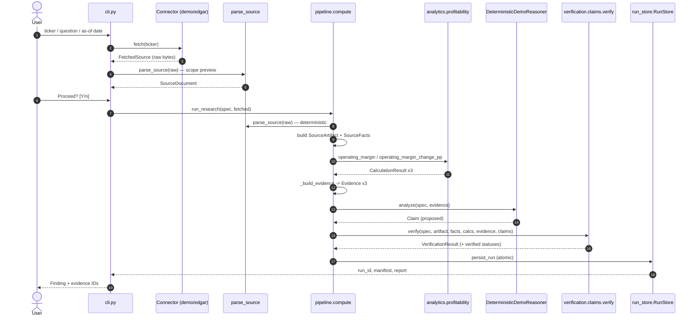

# Execution flow

This page traces one complete run end to end, then follows the same run through
every model in the lineage using the **real** artifacts a demo run produced.
The transcript, JSON, and report excerpts below are copied from an actual
`DEMO` execution (`RUN-20260809-001`), lightly abridged.

## Sequence of one run



`parse_source` runs twice: once in the CLI to build the scope preview, and once
inside `compute()` as part of the deterministic core. Both calls are pure
functions of the same preserved bytes, so they agree.

## The lineage, model by model

The pipeline realizes one contract:

```text
SourceArtifact -> SourceFact -> CalculationResult -> Evidence -> Claim -> verified report
```

### 1. Raw CLI input

The user accepts all three defaults (`DEMO`, the default question, and today's
date):

```console
Ticker [DEMO]:
> Research question [Is operating profitability improving?]:
> As-of date [2026-08-09]:
>
Research scope

  Company: Demonstration Company
  Ticker: DEMO
  Question: Is operating profitability improving?
  As-of date: August 9, 2026
  Historical periods: 2025-Q2 and 2026-Q2
  Data source: Synthetic bundled fixture

Proceed? [Y/n]:
```

### 2. `ResearchSpec` — validated user input (`spec.json`)

The periods and company identity come from the parsed source document, not from
free-form typing. `historical_periods` is role-ordered `(previous, current)`.

```json
{
  "as_of_date": "2026-08-09",
  "company_id": "demo-company-000001",
  "company_name": "Demonstration Company",
  "historical_periods": ["2025-Q2", "2026-Q2"],
  "pipeline_version": "0.1.0",
  "question": "Is operating profitability improving?",
  "ticker": "DEMO"
}
```

### 3. `SourceArtifact` — the preserved raw input

`compute()` builds the artifact from the exact bytes the connector returned. The
`SourceArtifact` is an in-memory model (it is not written as a standalone
file); its identity surfaces in `facts.json` (`source_artifact_id`) and in
`manifest.json` (`source_hashes`, `source_name`, `source_version`,
`source_type`). For this run the preserved fixture is 1400 bytes and its SHA-256
is the `content_hash`:

```json
{
  "artifact_id": "ART-f2b516c96247",
  "source_type": "synthetic_fixture",
  "source_name": "demo-company-facts.json",
  "source_version": "1.0.0",
  "content_hash": "1c7cf5bba8aaa5bb9111fea1941ae53b79eb11de54e668315e450d4c70aaade7",
  "known_at": "2026-07-15T00:00:00+00:00",
  "local_path": "raw/demo-company-facts.json",
  "byte_size": 1400
}
```

`artifact_id` is content-derived: `ART-` + `sha256(canonical JSON)[:12]` over the
source type, name, version, and content hash. `local_path` is relative to the
run directory — absolute paths never enter hashed content.

### 4. `SourceFact` — validated observations (`facts.json`)

Four facts, two per period (revenue and operating income). `known_at` is the
fixture's filing timestamp; `source_locator` is a JSON pointer into the raw
bytes. Abridged to the two 2025-Q2 facts:

```json
[
  {
    "concept": "revenue",
    "fact_id": "FACT-fde4b197a83c",
    "known_at": "2025-07-15T00:00:00+00:00",
    "observation_period": "2025-Q2",
    "source_artifact_id": "ART-f2b516c96247",
    "source_locator": "/periods/0/facts/0",
    "subject_id": "demo-company-000001",
    "unit": "USD",
    "validation_status": "valid",
    "value": "1000000000"
  },
  {
    "concept": "operating_income",
    "fact_id": "FACT-59fc3cdc0b33",
    "known_at": "2025-07-15T00:00:00+00:00",
    "observation_period": "2025-Q2",
    "source_artifact_id": "ART-f2b516c96247",
    "source_locator": "/periods/0/facts/1",
    "subject_id": "demo-company-000001",
    "unit": "USD",
    "validation_status": "valid",
    "value": "84000000"
  }
]
```

The 2026-Q2 facts (`FACT-984d1189dc7a` revenue `1000000000`, `FACT-9cff5a7d197e`
operating income `101000000`) follow the same shape. Every `value` is a string:
the fixture parser forbids JSON floats outright.

### 5. `CalculationResult` — authoritative numbers (`calculations.json`)

Three calculations: one operating margin per period, plus the change in
percentage points. Margins are ratios quantized to six decimals; the change is
in percentage points quantized to four. `input_fact_ids` and
`input_calculation_ids` are role-ordered.

```json
[
  {
    "calculation_id": "CALC-cf3c3f6a4f26",
    "calculation_name": "operating_margin",
    "calculation_version": "1.0.0",
    "input_calculation_ids": [],
    "input_fact_ids": ["FACT-59fc3cdc0b33", "FACT-fde4b197a83c"],
    "observation_period": "2025-Q2",
    "subject_id": "demo-company-000001",
    "unit": "ratio",
    "value": "0.084"
  },
  {
    "calculation_id": "CALC-fb3e8afffc03",
    "calculation_name": "operating_margin",
    "calculation_version": "1.0.0",
    "input_calculation_ids": [],
    "input_fact_ids": ["FACT-9cff5a7d197e", "FACT-984d1189dc7a"],
    "observation_period": "2026-Q2",
    "subject_id": "demo-company-000001",
    "unit": "ratio",
    "value": "0.101"
  },
  {
    "calculation_id": "CALC-bb36572ac2e1",
    "calculation_name": "operating_margin_change_pp",
    "calculation_version": "1.0.0",
    "input_calculation_ids": ["CALC-fb3e8afffc03", "CALC-cf3c3f6a4f26"],
    "input_fact_ids": [
      "FACT-9cff5a7d197e", "FACT-984d1189dc7a",
      "FACT-59fc3cdc0b33", "FACT-fde4b197a83c"
    ],
    "observation_period": "2025-Q2..2026-Q2",
    "subject_id": "demo-company-000001",
    "unit": "percentage_points",
    "value": "1.7"
  }
]
```

`0.084 = 84000000 / 1000000000`; `0.101 = 101000000 / 1000000000`;
`(0.101 - 0.084) * 100 = 1.7` percentage points.

### 6. `Evidence` — citable, typed results (`evidence.json`)

One evidence record per calculation, carrying the full source-fact lineage plus
a presentation-only `display_value`. `display_value` is excluded from every
hash. Abridged to the first and last:

```json
[
  {
    "calculation_id": "CALC-cf3c3f6a4f26",
    "display_value": "8.4%",
    "evidence_id": "EV-9d33ded8a427",
    "evidence_type": "calculation",
    "known_at": "2025-07-15T00:00:00+00:00",
    "metric": "operating_margin",
    "observation_period": "2025-Q2",
    "source_fact_ids": ["FACT-59fc3cdc0b33", "FACT-fde4b197a83c"],
    "status": "verified",
    "subject_id": "demo-company-000001",
    "unit": "ratio",
    "value": "0.084"
  },
  {
    "calculation_id": "CALC-bb36572ac2e1",
    "display_value": "1.7 percentage points",
    "evidence_id": "EV-d1e9faaf6787",
    "evidence_type": "calculation",
    "known_at": "2026-07-15T00:00:00+00:00",
    "metric": "operating_margin_change_pp",
    "observation_period": "2025-Q2..2026-Q2",
    "source_fact_ids": [
      "FACT-9cff5a7d197e", "FACT-984d1189dc7a",
      "FACT-59fc3cdc0b33", "FACT-fde4b197a83c"
    ],
    "status": "verified",
    "subject_id": "demo-company-000001",
    "unit": "percentage_points",
    "value": "1.7"
  }
]
```

The middle record (`EV-649d8a693225`) is the 2026-Q2 margin, `10.1%` / `0.101`.
Evidence is created with `status: "unverified"`; the verifier stamps it
`verified` (or `rejected`) in place.

### 7. `Claim` — a structured statement whose numbers cite evidence (`claims.json`)

The reasoner assembles one claim. Every asserted number carries the evidence ID
it is copied from, and the `statement` is rendered purely from the structured
values.

```json
[
  {
    "claim_id": "CL-03d483aef9c0",
    "claim_type": "profitability_change",
    "direction": "increased",
    "evidence_ids": ["EV-9d33ded8a427", "EV-649d8a693225", "EV-d1e9faaf6787"],
    "numeric_assertions": [
      {"asserted_value": "0.084", "evidence_id": "EV-9d33ded8a427", "metric": "operating_margin", "unit": "ratio"},
      {"asserted_value": "0.101", "evidence_id": "EV-649d8a693225", "metric": "operating_margin", "unit": "ratio"},
      {"asserted_value": "1.7", "evidence_id": "EV-d1e9faaf6787", "metric": "operating_margin_change_pp", "unit": "percentage_points"}
    ],
    "statement": "Operating margin increased from 8.4% to 10.1%, an improvement of 1.7 percentage points.",
    "status": "verified",
    "subject_id": "demo-company-000001"
  }
]
```

### 8. `VerificationResult` — the deterministic gate (`verification.json`)

Every check passes, so the claim is verified and there are no failures.
`checked_at` is a wall-clock timestamp and is excluded from all hashes.

```json
{
  "checked_at": "2026-08-09T05:46:40.882636+00:00",
  "failures": [],
  "rejected_claim_ids": [],
  "status": "passed",
  "verified_claim_ids": ["CL-03d483aef9c0"],
  "verifier_version": "1.0.0"
}
```

Had any check failed, the report would publish **no** claims and the process
would exit `1`. See [Interpreting results](usage/interpreting-results.md) and
the failure codes in the [data models reference](reference/data-models.md).

### 9. `report.txt` — the publishable result

Only verified structured content reaches the report:

```text
Operating profitability of Demonstration Company (DEMO)
=======================================================

Run: RUN-20260809-001
Verification: passed

Finding:
  Operating margin increased from 8.4% to 10.1%, an improvement of 1.7
  percentage points.
  Evidence: EV-9d33ded8a427, EV-649d8a693225, EV-d1e9faaf6787

Synthetic demonstration data — not investment advice.
```

### 10. `RunManifest` — the integrity record (`manifest.json`)

The manifest records the per-stage hashes, source identity, calculation
versions, and final status. `run_id` and `created_at` identify the execution
and are excluded from replay comparison; everything else is compared.

```json
{
  "calculation_versions": {
    "operating_margin": "1.0.0",
    "operating_margin_change_pp": "1.0.0"
  },
  "calculations_hash": "909f4511e46516c55de571abefeeebe6a4b7b4bddfe147c725c4903617df8142",
  "claims_hash": "5123f08dc100ec656c608d26b1752670097f3183d9082a4181cc3c29fabce9f0",
  "created_at": "2026-08-09T05:46:40.883059+00:00",
  "evidence_hash": "58227f746c75a12d45d11664a6ef3e3697e25a5bc67e33d79e910d581b4f901d",
  "facts_hash": "a1cd41ebfaf9dd4315a73acc56a72d8d161797a6aa7cf256848eb6e0a889b3e9",
  "final_status": "passed",
  "input_hash": "f2cb65fe4dbb01b63704cec2a432ea624664663f95203568ae57602e869b0a0f",
  "pipeline_version": "0.1.0",
  "run_id": "RUN-20260809-001",
  "source_hashes": {
    "demo-company-facts.json": "1c7cf5bba8aaa5bb9111fea1941ae53b79eb11de54e668315e450d4c70aaade7"
  },
  "source_name": "demo-company-facts.json",
  "source_type": "synthetic_fixture",
  "source_version": "1.0.0",
  "verification_hash": "df9b4d4502cffb9b3d9c6c457f1babe49d802b0116dad953db67c7ada1c93514"
}
```

Replaying this run recomputes each stage from `spec.json` and the preserved
`raw/demo-company-facts.json` and checks both the stored files and the
recomputed values against these hashes. See [Replay](usage/replay.md).

## The numbers: 8.4%, 10.1%, and 1.7 percentage points

The finding turns on three values:

| Period | Operating margin (ratio) | Displayed |
| --- | --- | --- |
| 2025-Q2 | `0.084` | 8.4% |
| 2026-Q2 | `0.101` | 10.1% |
| Change | `1.7` percentage points | 1.7 pp |

STRIX reports the change as **1.7 percentage points**, not "1.7 percent". The
distinction is deliberate:

- **Percentage points** measure the *arithmetic difference* between two
  percentages: `10.1% - 8.4% = 1.7 pp`. This is exactly what
  `operating_margin_change_pp` computes: `(0.101 - 0.084) * 100 = 1.7`.
- **Percent** (a *relative* change) would divide by the base:
  `(0.101 - 0.084) / 0.084 ≈ 0.202`, i.e. about **+20.2%**. The margin grew by
  roughly a fifth of its former size.

These are different quantities. Reading "1.7 percentage points" as "1.7 percent"
would understate the move by more than tenfold: a relative increase of 1.7%
would lift an 8.4% margin only to about 8.54% (≈ +0.14 pp), whereas the real
2026-Q2 margin is 10.1%. STRIX only ever reports the percentage-point figure for
this metric, and the verifier re-renders the sentence from the structured
values so the displayed "from", "to", and "difference" always add up at one
decimal place.
