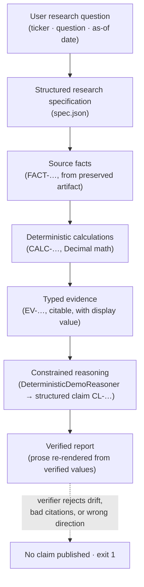

# STRIX

**Structured Traceability, Retrieval, and Intelligence eXtraction** is an
evidence-grounded research CLI. It answers a financial research question by
building a typed, hash-verified chain from a preserved source document all the
way to a rendered sentence — so every number it prints can be traced back to the
bytes it came from and the arithmetic that produced it.

The design premise is narrow and deliberate:

> **Numbers you can trace beat numbers you must trust.**

A conventional analysis tool hands you a figure and asks for your confidence.
STRIX hands you a figure *and* the lineage behind it: the source artifact, the
extracted facts, the `Decimal` calculation, the citable evidence, the structured
claim, and a deterministic verifier that re-derives the prose from the verified
values and refuses to publish anything that does not add up. If verification
fails, **no claim is published** and the process exits non-zero.

!!! warning "Not investment advice"
    STRIX is a research and decision-support prototype. It is **not** an
    automated trading system and **not** a source of investment advice. It
    places no trades and makes no recommendations. Output labelled synthetic is
    fictional and must never be presented as real financial data.

---

## What it does today

The current prototype (`strix 0.1.0`) answers **one** question type:

> *Has operating profitability improved year-over-year?* — the change in
> operating margin between two year-over-year quarters, reported in
> **percentage points**.

It draws on two data sources:

| Ticker | Source | Network |
|---|---|---|
| `DEMO` | Bundled synthetic fixture — a fictional "Demonstration Company" | None. Fully offline. |
| Any real ticker (e.g. `AAPL`) | [SEC EDGAR](https://www.sec.gov/) company facts (XBRL, as filed) | At fetch time only |

No API keys or credentials are required. For real tickers STRIX queries the
public EDGAR API with a fair-access `User-Agent` header, then **preserves the
raw fetched bytes inside the run directory** — so replaying any run, including a
real-data run, never touches the network.

### What it intentionally does not do

STRIX is scoped down on purpose. In this version it has:

- **No LLM calls.** The reasoner is fixed, auditable Python
  (`DeterministicDemoReasoner`). No language-model API is invoked anywhere.
- **No database or object storage.** Runs are plain JSON files on the local
  filesystem. There is no Postgres, Supabase, R2, pgvector, or Elasticsearch.
- **No web UI.** It is a terminal program.
- **No portfolio, macro, or market-data integrations.**
- **No forecasts or machine-learning models.** Every reported figure is exact
  arithmetic over filed values, never a prediction.
- **No trading and no investment advice.**

Planned directions are described separately in the
[roadmap](development/roadmap.md); this documentation otherwise describes only
what the code implements.

---

## Why deterministic analysis is separated from reasoning

STRIX draws a hard line between *computing the numbers* and *reasoning about
them*.

All authoritative arithmetic — extracting facts, computing operating margins,
computing the percentage-point change — is deterministic `Decimal` math.
Binary floating point is rejected at every boundary (the data models, canonical
JSON serialization, and JSON parsing), so a value cannot silently lose precision.
Identical inputs always produce identical content-derived IDs and identical
hashes.

The reasoner sits *behind* that arithmetic. It receives only the research
specification and the already-computed, already-typed evidence bundle
(`Reasoner` protocol, in `strix.reasoning.base`). It never invents ratios,
never sees future data, and cannot override a verification result. Today that
reasoner is deterministic Python. A future schema-constrained LLM adapter would
plug in behind **the same protocol and the same verifier** — which is exactly
why the boundary exists: the language model, when one arrives, is confined to
selecting and phrasing from verified evidence, and the deterministic verifier
still has the last word.

See [the architecture overview](overview.md) for how these layers
fit together.

---

## The lineage: from bytes to a verified sentence

Every run threads six typed stages. Facts, calculations, evidence, and claims
carry **content-derived IDs** — a type prefix plus the first twelve hex
characters of the SHA-256 of their canonical JSON — so the identity of a value
*is* its content.

| Stage | What it is | ID | From the DEMO run |
|---|---|---|---|
| **Source artifact** | The preserved raw source bytes (fixture or filing), hashed and stored under `raw/` | `ART-…` | `ART-f2b516c96247` |
| **Source fact** | A single validated value pulled from the artifact, with its subject, unit, period, and known-at date | `FACT-…` | operating income `84000000` USD, 2025-Q2 |
| **Calculation** | A deterministic `Decimal` result over facts — e.g. operating margin, or the percentage-point change | `CALC-…` | operating margin `0.084` (ratio) |
| **Evidence** | A calculation wrapped as a citable, typed unit with a presentation `display_value` | `EV-…` | `EV-9d33ded8a427` → `8.4%` |
| **Claim** | A structured assertion citing evidence, with a direction and numeric assertions the verifier checks | `CL-…` | `CL-03d483aef9c0`, direction `increased` |
| **Report** | The rendered terminal output — its prose re-derived from verified values | *(run-scoped)* | see below |

A **hash proves content identity and integrity — not that the content is true.**
Provenance guarantees the number you read is the number that was computed from
the bytes on record; whether those bytes reflect reality is a separate question.

Run IDs (`RUN-YYYYMMDD-NNN`) identify *executions*, not content, and are the one
thing that is expected to differ between two otherwise-identical runs.



---

## A real run

The DEMO ticker runs entirely offline. Pressing Enter at each prompt accepts the
defaults shown in brackets:

```text
STRIX — Structured Traceability, Retrieval, and Intelligence eXtraction
Evidence-grounded research prototype

Ticker [DEMO]:
> Research question [Is operating profitability improving?]:
> As-of date [2026-08-09]:
>
Research scope

  Company: Demonstration Company
  Ticker: DEMO
  Question: Is operating profitability improving?
  As-of date: August 9, 2026
  Historical periods: 2025-Q2 and 2026-Q2
  Data source: Synthetic bundled fixture

Proceed? [Y/n]:
[1/6] Preserving source artifact........ complete
[2/6] Validating source facts........... complete
[3/6] Calculating operating margins..... complete
[4/6] Building evidence................. complete
[5/6] Constructing structured claim..... complete
[6/6] Verifying claim................... passed

Finding

Operating margin increased from 8.4% to 10.1%, an
improvement of 1.7 percentage points.
[EV-9d33ded8a427, EV-649d8a693225, EV-d1e9faaf6787]

Verification: Passed
Research run: RUN-20260809-001

Synthetic demonstration data — not investment advice.
```

The reported change is **1.7 percentage points** (10.1% − 8.4%), which STRIX is
careful to distinguish from the ~20.2% *relative* change ((10.1 − 8.4) / 8.4).
The finding cites the three evidence units it is built from, and the displayed
`from` / `to` / `difference` values always reconcile at one decimal place.

---

## Where to go next

- **[Quickstart](getting-started/quickstart.md)** — install and run the offline
  DEMO in a few minutes, then try a real ticker.
- **[Architecture overview](overview.md)** — the modules, the
  execution flow, and the deterministic/reasoning boundary in depth.
- **[Command reference](usage/command-reference.md)** — every implemented
  command, option, and environment variable.
