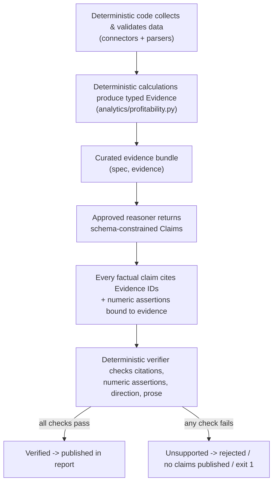

# The LLM boundary

This is the most safety-critical design decision in STRIX: a language model may
propose how to phrase a finding, but it is **never** trusted to decide what is
true. Authoritative numbers come only from deterministic calculations, and a
deterministic verifier rejects any claim whose numbers or prose it cannot
reproduce from the evidence.

!!! warning "The current build calls no LLM"
    STRIX's only reasoner today is `DeterministicDemoReasoner` — fixed,
    auditable Python, **not** an LLM. **No external LLM API is called anywhere
    in this codebase.** Everything below describes the *intended* boundary that
    a future schema-constrained reasoner would sit behind. It is documented here
    because the boundary is designed for it now; the feature itself is on the
    [roadmap](development/roadmap.md).

## The reasoner seam

Reasoning plugs in behind one narrow protocol. The reasoner receives **only**
the research spec and the curated evidence bundle — no files, environment,
network, credentials, or terminal:

```python
class Reasoner(Protocol):
    """Turns a curated evidence bundle into structured, citable claims."""

    def analyze(self, spec: ResearchSpec, evidence: list[Evidence]) -> list[Claim]:
        """Construct claims that cite the supplied evidence by ID."""
        ...
```

The signature is the contract: a reasoner cannot reach for a price it
"remembers", open a file, or call the network, because it is handed neither the
means nor the data to do so. Its only raw material is the typed `Evidence` the
deterministic core already built and will re-verify.

This isolation is enforced by a test — `tests/test_cli.py::TestReasonerIsolation`
— which blocks `builtins.open` and `builtins.input`, then runs the reasoner and
asserts it still produces exactly one claim citing exactly the supplied
evidence. A reasoner that tried to read a file or the terminal would fail the
suite.

## The intended process



Step by step:

1. **Deterministic code collects and validates data.** Connectors fetch raw
   bytes; parsers normalize them into typed facts. Floats are refused; every
   value is `Decimal`.
2. **Deterministic calculations produce typed evidence.** Only
   `analytics/profitability.py` computes authoritative numbers, and each
   `Evidence` record carries its full lineage back to a preserved artifact.
3. **A curated evidence bundle goes to an approved reasoner.** The reasoner sees
   `(spec, evidence)` and nothing else.
4. **The reasoner returns schema-constrained claims.** A claim is a typed
   `Claim` with a bounded `claim_type`, a `direction`, cited `evidence_ids`, and
   `numeric_assertions` — not free-form text with numbers baked in.
5. **Every factual claim cites evidence IDs.** Each `NumericAssertion` names the
   `evidence_id` it is copied from; a claim's asserted evidence must also be in
   its `evidence_ids`.
6. **The deterministic verifier checks the claim.** It confirms every citation
   resolves, belongs to the subject, was knowable by the as-of date, and is
   verified; that every assertion equals its evidence value and unit exactly;
   that the required comparison evidence is all present and asserted; that the
   `direction` matches the sign of the change evidence; and that the `statement`
   prose equals a fresh deterministic re-render of the structured values.
7. **Unsupported claims do not ship.** A claim that fails any check is marked
   `rejected`. If verification fails overall, the report publishes **no** claims
   at all — not even the ones that individually passed — and the process exits
   `1`.

## What an LLM must NOT be trusted to do

| An LLM must not... | Why / how it is prevented |
| --- | --- |
| Calculate authoritative financial ratios | Numbers are computed only in `analytics/profitability.py`. Any asserted value that differs from its cited evidence fails with `assertion_value_mismatch`. |
| Supply remembered prices or figures from training | Every `NumericAssertion` must equal a cited `Evidence.value`; an assertion citing evidence the claim does not list fails with `assertion_evidence_not_cited`, and a citation to nonexistent evidence fails with `unknown_evidence`. |
| Fabricate missing context or narrative | The `statement` is re-rendered deterministically by the verifier from the structured values; any drift fails with `statement_mismatch`. Only the bounded `profitability_change` claim shape is accepted. |
| Silently select undocumented or unfiltered data | The reasoner is handed a fixed evidence list and cannot introduce new evidence; every evidence record must resolve `Evidence -> CalculationResult -> SourceFact -> SourceArtifact` or it is rejected (`incomplete_lineage`, `unknown_calculation`, `missing_source_fact`, `artifact_mismatch`). |
| Assert a conclusion the numbers do not support | The `direction` must match the sign of the change evidence, or the claim fails with `direction_mismatch`; required comparison evidence must all be cited (`missing_comparison_evidence`) and asserted (`missing_assertion`). |
| Override or bypass a failed verification | A failed verification publishes no claims and exits `1`; the report reads "No verified finding." There is no code path by which a reasoner's output reaches the report without passing the verifier. |
| Place trades or give investment advice | STRIX has no trading capability and no brokerage integration. Every report carries a not-investment-advice disclaimer. |

The verifier "performs no new financial calculation; its only independent
recomputations are the direction sign check and the prose re-rendering." That
narrowness is intentional: the trusted checker stays small and auditable while
the untrusted proposer can be as sophisticated as a future LLM.

## Same protocol, same verifier

A future schema-constrained LLM adapter would implement the exact `Reasoner`
protocol above and sit behind the exact same verifier. Nothing downstream
changes: the LLM's claims are proposals, the verifier is the gate, and the
[deterministic boundary](deterministic-boundary.md) keeps the LLM — like the
network and the clock — firmly outside the reproducible core. See the
[roadmap](development/roadmap.md) for status and
[Adding reasoners](development/adding-reasoners.md) for how the seam is
extended.
