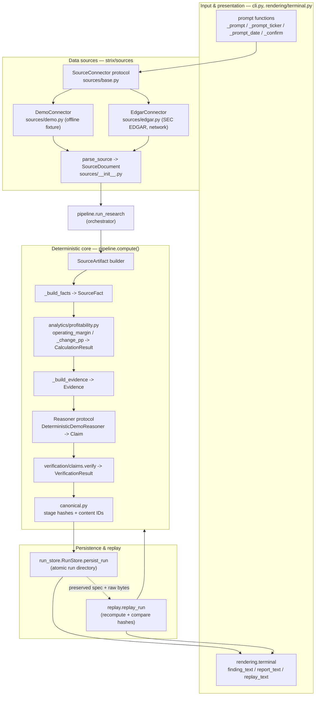

# Component architecture

STRIX is a small, layered Python package. Input and presentation live at the
edges; a single deterministic core does all of the calculation, evidence
building, reasoning, and verification; persistence and replay wrap the core so
every run can be reproduced from its preserved inputs.

The data flow is one direction:

```text
CLI input  ->  connector fetch  ->  deterministic core  ->  run directory  ->  terminal
                                    (compute + verify)       (persisted)        replay
```

!!! warning "Synthetic data, not investment advice"
    The `DEMO` ticker runs entirely offline on a bundled synthetic fixture for
    a fictional "Demonstration Company". Real tickers fetch public SEC EDGAR
    filings. STRIX produces no investment advice and cannot place trades.

## Module map



The one seam that touches the network is `EdgarConnector.fetch`; the one seam
that reads the wall clock is `SystemClock.now`. Both sit **outside**
`pipeline.compute`, so the deterministic core never depends on either — see
[Deterministic boundary](deterministic-boundary.md).

## Components

The table below maps the conceptual component names used in the design notes
to the modules and symbols that actually implement them, with each component's
determinism status. Every component shipping today is deterministic; the only
planned probabilistic component is a future LLM reasoner (see
[LLM boundary](llm-boundary.md) and the [roadmap](development/roadmap.md)).

| Design-spec component | Real module / symbol | Deterministic? |
| --- | --- | --- |
| Input interpreter | `cli.py` — `_prompt`, `_prompt_ticker`, `_prompt_date`, `_confirm` | Yes (given input); pure I/O, no calculation |
| Orchestrator | `pipeline.py` — `run_research` | Yes; delegates all content to `compute()` |
| Deterministic core | `pipeline.py` — `compute` | Yes; pure function of spec + raw bytes + reasoner |
| Connector interface | `sources/base.py` — `SourceConnector` protocol | Interface only |
| DEMO connector | `sources/demo.py` — `DemoConnector` | Yes; fully offline, reads bundled fixture |
| EDGAR connector | `sources/edgar.py` — `EdgarConnector` | Fetch touches network; bytes are then preserved |
| Normalization layer | `sources/base.py` — `SourceDocument`, built by `parse_demo_fixture` / `parse_companyfacts` | Yes; pure function of preserved bytes |
| Calculation engine | `analytics/profitability.py` — `operating_margin`, `operating_margin_change_pp` | Yes; exact `Decimal` in a local context |
| Evidence builder | `pipeline.py` — `_build_facts`, `_build_evidence` | Yes; content-derived IDs |
| Reasoner | `reasoning/base.py` — `Reasoner` protocol; `reasoning/deterministic_demo.py` — `DeterministicDemoReasoner` | Yes today (fixed Python). Future LLM adapter is the only planned probabilistic component |
| Verifier | `verification/claims.py` — `verify` | Yes; re-derives direction and re-renders prose |
| Report builder | `pipeline.py` — `build_report` closure; `rendering/terminal.py` — `report_text` / `finding_text` | Yes; renders only verified structured content |
| Canonical layer | `canonical.py` — `canonical_hash`, `make_id`, `to_jsonable` | Yes; the single source of hashing rules |
| Run store | `run_store.py` — `RunStore.persist_run` | Yes; atomic commit, no content decisions |
| Replay | `replay.py` — `replay_run` | Yes; recomputes with `compute()` and compares hashes |

## Layer responsibilities

**Input & presentation (`cli.py`, `rendering/terminal.py`).** The CLI is a
presentation and input layer only. Its module docstring states it plainly:
"It performs no financial calculation, builds no evidence, and verifies
nothing." It gathers a ticker, question, and as-of date, shows the research
scope, asks for confirmation, and hands a validated `ResearchSpec` to the
orchestrator. `rendering/terminal.py` formats already-computed results
(findings, the `report.txt` body, and the replay table) and may not calculate,
mutate evidence, or verify anything.

**Data sources (`strix/sources`).** Each connector implements
`SourceConnector.fetch(ticker) -> FetchedSource`, returning raw bytes plus a
source identity. `DemoConnector` reads the bundled fixture offline;
`EdgarConnector` fetches SEC EDGAR company facts over the network (no API key;
a fair-access `User-Agent`). Parsing is separate and deterministic:
`parse_source` dispatches on the source type to `parse_demo_fixture` or
`parse_companyfacts`, each producing a normalized `SourceDocument`. Because the
raw bytes are preserved per run, parsing during replay is byte-identical and
offline. See [Provenance](provenance.md) for the EDGAR point-in-time rules.

**Deterministic core (`pipeline.compute`).** One pure function performs the
whole pipeline in order: build the `SourceArtifact` from the preserved bytes,
extract `SourceFact`s, run the calculations, build `Evidence`, ask the reasoner
for `Claim`s, verify, and compute the per-stage canonical hashes. It receives
`checked_at` from the caller but excludes it from every hash. The
[evidence model](evidence-model.md) and [execution flow](execution-flow.md)
pages walk this in detail.

**Calculation engine (`analytics/profitability.py`).** The only place
authoritative financial numbers are produced. `operating_margin` returns a
ratio quantized to six decimal places; `operating_margin_change_pp` returns the
change in percentage points quantized to four. All arithmetic runs in a local
`Decimal` context so the global context is never mutated.

**Reasoning (`reasoning/`).** The `Reasoner` protocol receives only
`(spec, evidence)`. Today the sole implementation, `DeterministicDemoReasoner`,
is fixed auditable Python — **not** an LLM, and no LLM API is called anywhere
in this codebase. It copies every asserted number from cited evidence. A future
schema-constrained LLM adapter would sit behind the same protocol and the same
verifier; that boundary is the subject of the [LLM boundary](llm-boundary.md)
page.

**Verification (`verification/claims.py`).** Two deterministic passes: evidence
lineage (`Evidence -> CalculationResult -> SourceFact -> SourceArtifact`) and
claim checks (every cited evidence exists, belongs to the subject, was knowable
by the as-of date, and is verified; every numeric assertion matches its
evidence exactly; the direction and the statement prose are independently
re-derived). A failed verification publishes **no** claims and the process exits
`1`.

**Persistence & replay (`run_store.py`, `replay.py`).** `RunStore.persist_run`
writes a complete run directory atomically (hidden staging directory committed
with a single `os.rename`). `replay_run` reloads the preserved spec and raw
bytes, recomputes with the same `compute()` function, and compares both the
stored-artifact hashes and the recomputed hashes against the manifest, stage by
stage. See [Storage](storage.md) and [Replay](usage/replay.md).

**Canonical layer (`canonical.py`).** Every hash and every content-derived ID
(`ART-`, `FACT-`, `CALC-`, `EV-`, `CL-`) flows through this module. Keys are
sorted, separators compact, floats forbidden, `Decimal` encoded as an exact
plain string, and datetimes normalized to UTC ISO 8601. A hash asserts content
identity and integrity — never that the content is factually true.
