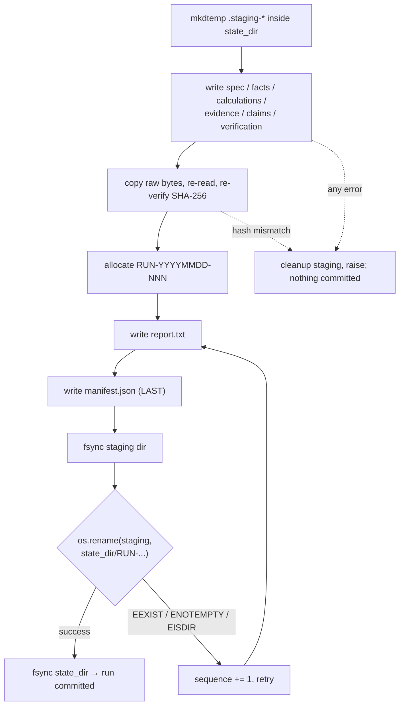

# Storage: the Run Store

STRIX persists each research run as a self-contained directory of JSON and text
artifacts. There is no database and no network dependency for reading a run —
only local files. This page documents the on-disk layout, the crash-safe write
protocol, the never-overwrite guarantee, run-ID allocation, and how state
directories are located. It reflects `src/strix/run_store.py` exactly.

## The run directory

A completed run is one directory named `RUN-YYYYMMDD-NNN` under the state
directory. From the ground-truth tree of `RUN-20260809-001`:

```
RUN-20260809-001
├── calculations.json
├── claims.json
├── evidence.json
├── facts.json
├── manifest.json
├── raw
│   └── demo-company-facts.json
├── report.txt
├── spec.json
└── verification.json
```

| File | Model / content | Role |
| --- | --- | --- |
| `spec.json` | `ResearchSpec` | The validated request: company, ticker, question, `as_of_date`, historical periods, pipeline version. Pure user input. |
| `raw/<source file>` | preserved bytes | The exact source bytes STRIX read (`demo-company-facts.json` for DEMO; `companyfacts-CIK##########.json` for EDGAR). Parsing and replay work from here. |
| `facts.json` | `tuple[SourceFact, …]` | Validated observations with `source_locator` back-pointers. |
| `calculations.json` | `tuple[CalculationResult, …]` | Deterministic, versioned margin and change results. |
| `evidence.json` | `tuple[Evidence, …]` | Citable typed results with full fact lineage, `display_value`, and verified/rejected `status`. |
| `claims.json` | `tuple[Claim, …]` | Structured claims with numeric assertions and prose. |
| `verification.json` | `VerificationResult` | Pass/fail, verified and rejected claim ids, and any failures. |
| `report.txt` | rendered text | The human-readable finding; embeds the run id. |
| `manifest.json` | `RunManifest` | The integrity record — per-stage hashes, calculation versions, source hashes, and `final_status`. Written last. |

All JSON is written with `pretty_json_bytes`: sorted keys, two-space indent,
the same Decimal-as-string and UTC-datetime encoding used for hashing, and a
trailing newline. Hashes, however, are always computed from the compact
canonical form (see [Evidence model](evidence-model.md#canonical-serialization-the-byte-exact-foundation)),
never from the pretty file, so reformatting the on-disk JSON does not by itself
change a stage hash — but changing any hashed value does.

## Atomic write protocol

The store is crash-safe by construction. `RunStore.persist_run` never mutates a
visible run directory in place; it builds the whole run in a hidden staging
directory and commits it with a single rename.



The mechanics, step by step:

1. **Staging inside the state directory.** A hidden directory is created with
   `tempfile.mkdtemp(dir=self.state_dir, prefix=".staging-")`. Because staging
   lives in the same directory as the final target, the committing rename never
   crosses a filesystem boundary and is therefore atomic.
2. **Per-file temp + fsync + atomic replace.** `_write_atomic` writes each
   artifact to a temp file in the target directory, `flush()`es, `os.fsync()`s
   the file descriptor, then `os.replace`s it into its final name inside
   staging. On error the temp file is unlinked.
3. **Raw copy re-verified.** `_preserve_raw` copies the source bytes, re-reads
   them, and aborts the whole run if the re-hash does not match the original.
4. **Manifest written last.** `report.txt` then `manifest.json` are the final
   writes; the manifest — the integrity record everything else is checked
   against — is always the last artifact created.
5. **Single-rename commit.** `os.rename(staging, state_dir/RUN-...)` promotes
   the complete run in one atomic step, followed by a best-effort directory
   fsync.

If anything raises before the rename, `_cleanup_staging` removes the staging
directory and the exception propagates — no partial run is ever left visible.

## Crashed runs leave only hidden staging

Because the run is assembled under a `.staging-*` name and only becomes visible
via the final rename, a crash mid-write leaves at most an ignorable hidden
directory. Run discovery only ever considers names matching the strict
`RUN-YYYYMMDD-NNN` pattern (`_next_sequence` filters on
`RUN_ID_PATTERN.fullmatch`), so stray staging directories are never listed as
runs and never affect sequence allocation. A regression test confirms that when
a write is forced to fail, no visible run directory appears.

## Never-overwrite guarantee

A completed run is immutable. The commit uses `os.rename` onto a fresh target
name; if a directory with that name already exists, the rename fails with
`EEXIST` / `ENOTEMPTY` / `EISDIR`, and the store increments the sequence number
and retries with the next id rather than clobbering the existing run:

```python
try:
    os.rename(staging, target)
except OSError as exc:
    if exc.errno in (errno.EEXIST, errno.ENOTEMPTY, errno.EISDIR):
        sequence += 1
        ...
        continue
    raise RunStoreError(...)
```

An existing `RUN-YYYYMMDD-NNN` can therefore never be overwritten by a new run.

## Run-ID allocation

Run IDs identify an **execution**, not content: `RUN-YYYYMMDD-NNN`, where the
date is the commit date and `NNN` is a zero-padded daily sequence.
`_next_sequence` scans the state directory for the day's existing run
directories and returns the highest sequence plus one; the sequence tops out at
`999` per day (`RunStoreError` if exhausted).

This is the one identifier in STRIX that is *not* content-derived, which is why
it — along with `created_at` and `report.txt`, which embed it — is excluded from
replay's hash comparison. Two otherwise identical runs get different run ids and
still replay to identical stage hashes.

Any run id accepted from user input is validated before any filesystem access.
`sanitize_run_id` requires a full match of `^RUN-\d{8}-\d{3}$` compiled with
`re.ASCII` (so Unicode-digit lookalikes are rejected), and `run_dir` further
resolves the path and confirms it stays directly inside the state directory.
See [Security](security.md#run-id-and-artifact-name-validation) for the threat
model.

## Locating the state directory

`resolve_state_dir` applies a fixed precedence:

1. the `--state-dir PATH` CLI flag, if given;
2. otherwise the `STRIX_STATE_DIR` environment variable, if set;
3. otherwise the default `./research_runs` (relative to the working directory,
   and gitignored).

```console
$ strix --state-dir /data/strix-runs
$ STRIX_STATE_DIR=/data/strix-runs strix
$ strix replay RUN-20260809-001 --state-dir /data/strix-runs
```

## Replay reads this store

`strix replay RUN-ID` re-executes the deterministic pipeline from a run's
preserved `spec.json` and `raw/` bytes and compares seven stages against the
manifest — both the **stored** artifact hashes (integrity) and the
**recomputed** hashes (reproducibility):

```
Replay verification

  Source artifact hash........ matched
  Input hash.................. matched
  Source facts hash........... matched
  Calculations hash........... matched
  Evidence hash............... matched
  Claims hash................. matched
  Verification status......... matched

Result: Deterministic replay passed
```

The full command reference and mismatch output are in
[Replaying a run](usage/replay.md).

### What replay does not guarantee

- **It does not re-fetch from EDGAR.** Replay reads only preserved bytes; it is
  always offline and never revalidates against the live SEC endpoints.
- **It does not prove the source was truthful.** A matching hash confirms the
  bytes and the computation are unchanged, not that the underlying data is
  correct (see [Provenance](provenance.md#what-provenance-does-and-does-not-establish)).
- **It does not integrity-check `report.txt` or `Evidence.display_value`.**
  Both are presentation-only and excluded from comparison: `report.txt` embeds
  the run id, and `display_value` is dropped from `evidence_hash`. Editing
  either will not be flagged by replay. The authoritative, hashed values live in
  the structured artifacts.

## Future storage backends

!!! note "Not implemented — roadmap only"
    STRIX currently uses **local JSON files only**. There is no database, no
    object store, and no search index. **PostgreSQL, Supabase, Cloudflare R2,
    pgvector, and Elasticsearch are not implemented** anywhere in this codebase.

The local layout is intentionally shaped so it *could* later map onto a
server-side store without changing the evidence model: the immutable structured
artifacts (`facts`, `calculations`, `evidence`, `claims`, `verification`,
`manifest`) are natural relational rows keyed by their content-derived ids, and
the `raw/` bytes are natural object-storage blobs keyed by their SHA-256. The
content-addressing that makes the local store replayable is exactly what would
make such a migration verifiable. Any such backend is a
[roadmap](development/roadmap.md) item, not a current capability.
