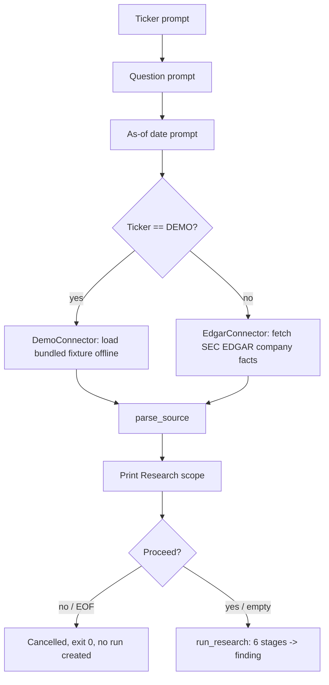

# Interactive mode

Running `strix` with no subcommand starts the interactive research flow. It
asks three questions, shows you the exact scope it is about to research, waits
for your confirmation, and then runs the deterministic pipeline and prints a
verified finding.

The command line layer performs no calculation of its own. It only collects
input, prints the scope, streams progress, and renders the already-computed
result:

```
CLI -> ResearchSpec -> run_research(spec) -> ResearchResult -> renderer
```

!!! warning "Two data sources"
    The `DEMO` ticker runs entirely offline against a bundled synthetic
    fixture describing a fictional company. Any other ticker fetches real
    filings from **SEC EDGAR** (no credentials required; the network is used
    only at fetch time, and the fetched bytes are preserved so replay stays
    offline). STRIX produces no investment advice and cannot place trades.

## The DEMO walkthrough

The following is the captured output of a full offline run against `DEMO`,
accepting every default:

```text
STRIX — Structured Traceability, Retrieval, and Intelligence eXtraction
Evidence-grounded research prototype

Ticker [DEMO]:
> Research question [Is operating profitability improving?]:
> As-of date [2026-08-09]:
> 
Research scope

  Company: Demonstration Company
  Ticker: DEMO
  Question: Is operating profitability improving?
  As-of date: August 9, 2026
  Historical periods: 2025-Q2 and 2026-Q2
  Data source: Synthetic bundled fixture

Proceed? [Y/n]: 
[1/6] Preserving source artifact........ complete
[2/6] Validating source facts........... complete
[3/6] Calculating operating margins..... complete
[4/6] Building evidence................. complete
[5/6] Constructing structured claim..... complete
[6/6] Verifying claim................... passed

Finding

Operating margin increased from 8.4% to 10.1%, an
improvement of 1.7 percentage points.
[EV-9d33ded8a427, EV-649d8a693225, EV-d1e9faaf6787]

Verification: Passed
Research run: RUN-20260809-001

Synthetic demonstration data — not investment advice.
exit_code=0
```

The final `exit_code=0` line is the recorded process exit status, not text
that STRIX prints.

## The three prompts

Each prompt shows its default in square brackets. The prompt line ends with a
`> ` continuation, and pressing Enter on an empty line accepts the bracketed
default. Every value you type is stripped of surrounding whitespace.

| Prompt | Default | Notes |
| --- | --- | --- |
| `Ticker [DEMO]:` | `DEMO` | Uppercased before validation. Empty accepts `DEMO`. |
| `Research question [Is operating profitability improving?]:` | `Is operating profitability improving?` | Free text; must be non-empty (the default is used when you press Enter). |
| `As-of date [today]:` | today's date | Point-in-time cutoff; only facts knowable on or before this date are used. |

The as-of default is the current date supplied by the system clock; in the
capture above it appears as `2026-08-09`.

### Ticker validation and re-prompt

The ticker is uppercased and then checked against the pattern
`^[A-Za-z][A-Za-z0-9.\-]{0,9}$` — it must start with a letter and may contain
up to ten letters, digits, `.`, or `-`. If the entry does not match, STRIX
prints this line and asks again, looping until a valid symbol is entered (or
the default is accepted):

```text
Please enter a ticker symbol (letters, digits, '.', '-'; e.g. DEMO or AAPL).
```

### As-of date re-prompt

The date must parse as an ISO `YYYY-MM-DD` calendar date. Any other input is
rejected with this line, and the prompt repeats:

```text
Please enter a date as YYYY-MM-DD.
```

## The scope summary

After the three prompts, STRIX acquires the source (see below), parses it, and
prints the scope it is about to research. The company name, resolved ticker,
historical periods, and data-source description come from the parsed source
document, not from what you typed:

```text
Research scope

  Company: Demonstration Company
  Ticker: DEMO
  Question: Is operating profitability improving?
  As-of date: August 9, 2026
  Historical periods: 2025-Q2 and 2026-Q2
  Data source: Synthetic bundled fixture
```

The `Data source` line is `Synthetic bundled fixture` for `DEMO` and
`SEC EDGAR company facts (live fetch, preserved per run)` for real tickers.

## Confirming: `Proceed? [Y/n]`

The confirmation prompt controls whether a run directory is created.

| Input (case-insensitive) | Result |
| --- | --- |
| empty (just Enter) | proceed — same as yes |
| `y`, `yes` | proceed |
| `n`, `no` | cancel |
| anything else | re-prompt with `Please answer y or n.` |

Choosing to proceed runs the six pipeline stages and writes a run directory.
Declining cancels cleanly:

```text
Proceed? [Y/n]: 
Cancelled. No research run was created.
exit_code=0
```

When you cancel at the confirmation prompt, STRIX exits with status `0` and
**no run directory is created** — nothing was persisted.

## Progress and the finding block

On confirmation, STRIX streams exactly six progress lines, one per pipeline
stage, then prints the finding block. The six labels are fixed and always
appear in this order:

```text
[1/6] Preserving source artifact........ complete
[2/6] Validating source facts........... complete
[3/6] Calculating operating margins..... complete
[4/6] Building evidence................. complete
[5/6] Constructing structured claim..... complete
[6/6] Verifying claim................... passed
```

The sixth line reports the verification outcome — `passed` or `failed` —
rather than `complete`.

The finding block that follows lists the verified statement, the evidence IDs
that support it (in square brackets), the verification status, the run ID, and
the source-appropriate disclaimer. When verification passes, the `Finding`
block shows the verified claim's statement and its citations. When it fails,
STRIX prints no finding, appends the list of verification failures, and exits
`1` — see [Interpreting results](interpreting-results.md).

## The EDGAR variant

Entering any ticker other than `DEMO` selects the SEC EDGAR connector. After
the three prompts, STRIX prints a fetch line before acquiring the filing, then
continues with the same scope-summary → confirm → progress → finding flow. The
captured output for `AAPL`:

```text
$ strix
STRIX — Structured Traceability, Retrieval, and Intelligence eXtraction
Evidence-grounded research prototype

Ticker [DEMO]:
> AAPL
Research question [Is operating profitability improving?]:
> 
As-of date [2026-08-09]:
> 
Fetching SEC EDGAR company facts for AAPL...

Research scope

  Company: Apple Inc.
  Ticker: AAPL
  Question: Is operating profitability improving?
  As-of date: August 9, 2026
  Historical periods: 2025-Q2 and 2026-Q2
  Data source: SEC EDGAR company facts (live fetch, preserved per run)

Proceed? [Y/n]: 
[1/6] Preserving source artifact........ complete
[2/6] Validating source facts........... complete
[3/6] Calculating operating margins..... complete
[4/6] Building evidence................. complete
[5/6] Constructing structured claim..... complete
[6/6] Verifying claim................... passed

Finding

Operating margin increased from 30.0% to 32.6%, an
improvement of 2.6 percentage points.
[EV-b38554906baa, EV-efc0b9ba93b5, EV-b25cb97df239]

Verification: Passed
Research run: RUN-20260809-001

Source: SEC EDGAR company facts, as filed. Research prototype output — not investment advice.
```

Notes on the EDGAR variant:

- The line `Fetching SEC EDGAR company facts for AAPL...` is printed after the
  three prompts, immediately before the network fetch. It is the only network
  activity in the whole flow.
- The `Company`, `Ticker`, and `Historical periods` shown in the scope come
  from the parsed filing: the entity name as filed (`Apple Inc.`), the resolved
  symbol, and the two year-over-year comparable quarters selected as of your
  date.
- The disclaimer differs from the DEMO run: it states the data is SEC EDGAR
  company facts, as filed, and that this is research-prototype output.

!!! warning "SEC-sourced runs use real filing data"
    An EDGAR run reports figures a real company filed with the SEC. The output
    is still research-prototype output and is not investment advice. The demo
    disclaimer, by contrast, explicitly labels the DEMO figures as synthetic.

## Source acquisition, step by step

The prompts and confirmation surround a single acquisition step. For `DEMO`,
the bundled fixture is loaded from disk; for any other ticker, the EDGAR
connector resolves the ticker to a CIK and downloads the company-facts JSON.
The raw bytes are then parsed into the scope you confirm.



## Exit and interruption behavior

| Situation | Message | Exit code |
| --- | --- | --- |
| Run completes, verification passes | finding block | `0` |
| Run completes, verification fails | finding block + failure list | `1` |
| Answer `n`/`no` at `Proceed?` | `Cancelled. No research run was created.` | `0` |
| End of input (EOF / Ctrl-D) at any prompt | `Cancelled. No research run was created.` | `0` |
| Interrupt (Ctrl-C) | `Cancelled.` | `130` |

Pressing **Ctrl-D** (EOF) at any prompt — the ticker, the question, the date,
or the confirmation — ends input cleanly: STRIX treats it as a cancellation,
prints `Cancelled. No research run was created.`, and exits `0`. No run
directory is created.

Pressing **Ctrl-C** raises a keyboard interrupt, which STRIX catches and turns
into the shorter message `Cancelled.` with exit code `130` (the conventional
"terminated by SIGINT" status).

## Related pages

- [Command reference](command-reference.md) — the full argparse surface and
  every implemented flag.
- [Research runs](research-runs.md) — what the confirmed run writes to disk.
- [Interpreting results](interpreting-results.md) — reading the finding
  sentence and understanding verification outcomes.
