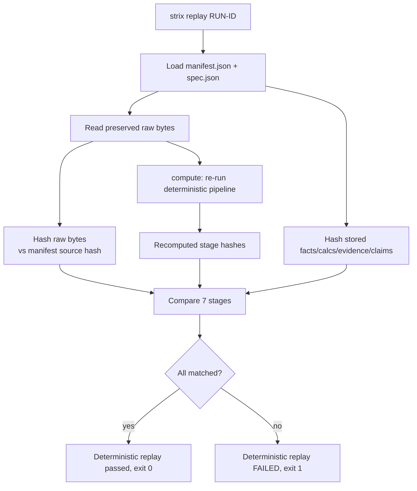

# Replay

`strix replay RUN-ID` recomputes a preserved run from its stored inputs and
checks that both the stored artifacts and the freshly recomputed results still
hash to what the run's manifest recorded. It is how STRIX proves, after the
fact, that a run has not been altered and that its pipeline is reproducible.

```console
$ strix replay RUN-20260809-001
```

!!! note "Replay is always offline"
    Replay never touches the network — even for a run whose source was SEC
    EDGAR. Every run preserves the raw source bytes it fetched
    (`raw/<source file>`), and replay recomputes from those preserved bytes.
    An EDGAR run is therefore as reproducible offline as a DEMO run.

## Why replay exists

Replay checks two independent properties, per stage:

- **Integrity** — the artifacts stored in the run directory still hash to what
  the manifest recorded. This detects tampering with the stored files.
- **Reproducibility** — recomputing everything from the preserved spec and raw
  source bytes yields the same deterministic hashes. This detects
  nondeterminism or contract drift. Stored calculations are never reused as if
  they were newly computed; the pipeline is re-run from the raw bytes.

A stage matches only if **both** checks agree with the manifest. Because the
recomputation uses the same deterministic core as the original run, a genuine,
untampered run reproduces exactly.

!!! warning "A hash proves identity, not truth"
    Matching hashes prove that content is byte-for-byte what it was and that
    recomputation is reproducible. They do **not** assert that the underlying
    figures are factually correct or that the finding is sound. Replay is an
    integrity and reproducibility check, not a fact check.

## A passing replay

When every stage matches, all seven rows read `matched` and the result is a
pass:

```text
Replay verification

  Source artifact hash........ matched
  Input hash.................. matched
  Source facts hash........... matched
  Calculations hash........... matched
  Evidence hash............... matched
  Claims hash................. matched
  Verification status......... matched

Result: Deterministic replay passed
```

Exit code `0`.

## A failing replay

If the preserved raw bytes are altered, replay fails. Below, tampering with the
raw fixture cascades: the raw hash no longer matches the manifest, the input
hash (spec + raw) no longer matches, and everything recomputed from the altered
bytes diverges from the recorded stage hashes:

```text
Replay verification

  Source artifact hash........ MISMATCH (preserved raw bytes differ from manifest)
  Input hash.................. MISMATCH (spec or raw fixture differs from original input)
  Source facts hash........... MISMATCH (recomputed hash differs from manifest)
  Calculations hash........... MISMATCH (recomputed hash differs from manifest)
  Evidence hash............... MISMATCH (recomputed hash differs from manifest)
  Claims hash................. MISMATCH (recomputed hash differs from manifest)
  Verification status......... MISMATCH (verification outcome differs)

Result: Deterministic replay FAILED
```

Exit code `1`.

## The seven compared stages

Replay always reports exactly these seven rows, in order:

| Row | What it compares |
| --- | --- |
| Source artifact hash | SHA-256 of the preserved raw bytes vs the manifest's recorded source hash. |
| Input hash | Hash of `{spec, raw SHA-256}` recomputed from stored inputs vs `manifest.input_hash`. |
| Source facts hash | Stored `facts.json` and recomputed facts, both vs `manifest.facts_hash`. |
| Calculations hash | Stored `calculations.json` and recomputed calculations, both vs `manifest.calculations_hash`. |
| Evidence hash | Stored `evidence.json` and recomputed evidence, both vs `manifest.evidence_hash`. |
| Claims hash | Stored `claims.json` and recomputed claims, both vs `manifest.claims_hash`. |
| Verification status | Stored and recomputed verification hash and the final status, all vs the manifest. |

## What is compared vs excluded

Replay compares content that is a deterministic function of the inputs and
excludes anything execution-specific.

**Compared:**

- The preserved raw source bytes (Source artifact hash).
- The input hash (spec plus the raw SHA-256).
- The facts, calculations, evidence, and claims stage hashes.
- The verification hash and final status.
- `known_at` timestamps — these are fixture/filing content (the demo's
  timestamps, or the SEC `filed` date), not wall clock, so they are part of the
  hashed content and **are** compared.

**Excluded** (execution-specific or presentation-only):

| Excluded | Why |
| --- | --- |
| `run_id` | Identifies an execution, not content. |
| `created_at` | Wall-clock timestamp of when the run was written. |
| `checked_at` | Wall-clock timestamp on the verification result. |
| `report.txt` | Human-readable text that embeds the run ID. |
| `Evidence.display_value` | Presentation-only rendering; the authoritative `value` is compared. |

Because the excluded fields never enter the hashes, replay of an untampered run
passes regardless of when it runs or which run ID it was assigned.

## Reading a mismatch

Each stage combines an integrity check and a reproducibility check, so a
`MISMATCH` detail tells you *which* check failed:

| Detail text | Meaning |
| --- | --- |
| `preserved raw bytes differ from manifest` | The stored raw source no longer hashes to the manifest — the `raw/` copy was altered. |
| `spec or raw fixture differs from original input` | The recomputed input hash (spec + raw) no longer matches — the spec or the raw bytes changed. |
| `stored artifact differs from manifest` | The stored `facts/calculations/evidence/claims` file no longer matches the manifest — that on-disk artifact was tampered with. |
| `recomputed hash differs from manifest` | Recomputing from the preserved inputs produced a different hash — nondeterminism, a contract/version change, or altered raw inputs feeding the recomputation. |
| `stored artifact unreadable` | The stored artifact could not be parsed. |
| `verification outcome differs` | The recomputed or stored verification hash, or the final status, disagrees with the manifest. |

In short: a **stored-artifact** difference points at tampering with files on
disk; a **recomputed** difference points at nondeterminism, contract drift, or
altered inputs. Altering the raw source typically triggers both, as shown in
the failing example above.

## How replay recomputes

Replay loads the manifest and spec, reads the preserved raw bytes, then runs
the same deterministic core (`compute`) that produced the original run —
parsing the raw bytes, rebuilding facts, calculations, evidence, and claims,
and verifying — using a fixed placeholder `checked_at` (which is excluded from
every hash). It then compares stored and recomputed hashes stage by stage.



## Exit codes

| Exit code | Meaning |
| --- | --- |
| `0` | Every stage matched. |
| `1` | One or more stages mismatched, or the run could not be loaded (invalid run ID, unknown run, unreadable manifest/spec). |
| `2` | argparse usage error (e.g. the `RUN-ID` argument was omitted). |

Loading failures are reported as `Error: <message>` on stderr — for example an
invalid run ID or a run that does not exist under the state directory. See
[Command reference](command-reference.md) for those messages, and
[Research runs](research-runs.md) for the manifest fields replay checks.
