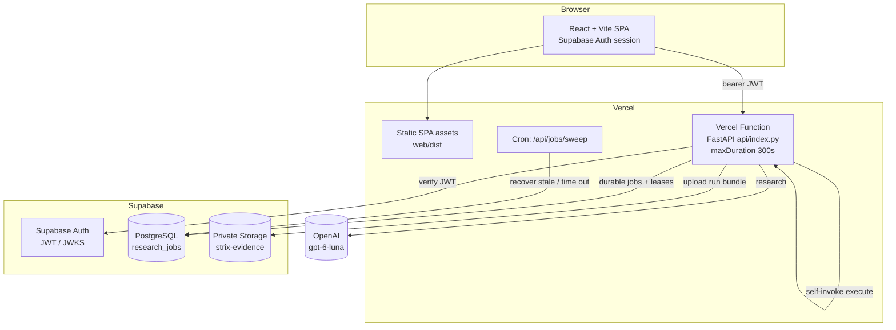

# STRIX on Vercel — Cloud Deployment

This document describes how STRIX runs as a persistent, authenticated,
cloud-hosted research application on **Vercel Functions** with **Supabase**
(PostgreSQL + Auth + Storage). It covers the architecture, configuration,
security model, CI/CD, troubleshooting, rollback, and the real cost/limit
envelope.

The research engine itself — bounded tool-calling, independent claim
verification, evidence lineage, and deterministic replay — is **unchanged** by
this deployment. The cloud layer only adds durable persistence, authentication,
and queue-ready execution *around* it.

---

## 1. Architecture



**Request-bound durable execution (the chosen model).** A research run fits
inside the engine's 120-second budget, comfortably under a single Vercel Fluid
Compute function's 300s `maxDuration`. So:

1. `POST /api/research` persists a `research_jobs` row (`status=queued`) and
   returns the id **immediately**.
2. It then fires a non-blocking self-invocation to the internal
   `POST /api/jobs/execute`, which runs on a *fresh* function invocation with its
   own full `maxDuration`.
3. The browser polls `GET /api/research/{id}`; progress and the final result are
   read from Postgres, so **closing the browser never loses the run**.
4. A cron sweeper (`/api/jobs/sweep`) recovers anything left queued (dropped
   trigger) or running with an expired lease (crashed invocation), and marks
   genuinely stuck jobs `timed_out`.

**Queue-ready.** Execution is driven by `strix.jobs.executor.execute_job`, which
knows nothing about Vercel or HTTP. Swapping the self-invocation trigger for a
durable queue + separate worker (see §7) requires no change to the research
engine — only a new `Trigger` implementation that calls the same `execute_job`.

---

## 2. Local vs hosted execution

| Concern | Local / offline dev | Hosted (Vercel + Supabase) |
|---|---|---|
| Job store | SQLite (`LocalJobStore`) | PostgreSQL (`SupabaseJobStore`) |
| Execution trigger | background thread (`ThreadTrigger`) | HTTP self-invoke (`HttpSelfTrigger`) + cron |
| Auth | `STRIX_AUTH_MODE=dev` (single dev user) | Supabase Auth JWT (required) |
| Artifact storage | local filesystem | Supabase Storage (`strix-evidence`) |
| Entry point | `uvicorn strix.webapi.cloud_app:app` or the CLI | `api/index.py` (ASGI) |

Backend selection is automatic: the Supabase store is used when
`STRIX_DATABASE_URL` is set (or `STRIX_PERSISTENCE_BACKEND=supabase`), otherwise
the SQLite store. The **CLI (`strix`) is unchanged** and continues to drive the
same research engine directly — the cloud layer is additive.

Run locally against SQLite with no cloud project:

```bash
pip install -e ".[cloud,web]"
export STRIX_AUTH_MODE=dev            # bypass auth for local dev only
export OPENAI_API_KEY=sk-...          # real research needs a real key
uvicorn strix.webapi.cloud_app:app --reload
# in another shell
cd web && npm install && npm run dev   # proxies /api to 127.0.0.1:8000
```

---

## 3. Vercel project configuration

`vercel.json` (repository root) configures everything:

- **Build**: `cd web && npm install && npm run build`, output `web/dist`.
- **Function**: `api/index.py` with `maxDuration: 300`, `memory: 1024`.
- **Rewrites**: `/api/*` → the function; everything else → `/index.html` (SPA
  client-side routing).
- **Cron**: `/api/jobs/sweep` every 15 minutes (adjust to plan limits).
- **Headers**: security headers on all routes; immutable caching for `/assets/*`.

The Python function installs only `requirements.txt` — the lightweight set
(FastAPI, OpenAI, httpx, psycopg, PyJWT). The heavy lakehouse/warehouse stack
(pyarrow, duckdb, snowflake) and dbt/Airflow are **excluded** from the function;
they belong to separate data-engineering infrastructure (§8).

### Link and deploy

```bash
vercel login                       # interactive — authorize the panther-byte team
vercel link --scope panther-byte   # create/link the 'strix' project
vercel env pull .env.vercel        # (optional) inspect configured env
vercel                             # protected preview deployment
# after validating the preview:
vercel --prod                      # production (from main; respects branch protection)
```

---

## 4. Authentication & access control

- **Provider**: Supabase Auth. The browser signs in and sends the access token as
  `Authorization: Bearer <jwt>`.
- **Verification** (`strix.auth.supabase_jwt`): server-side, supporting both
  asymmetric JWKS (current default, fetched from
  `${SUPABASE_URL}/auth/v1/.well-known/jwks.json`) and legacy HS256
  (`SUPABASE_JWT_SECRET`). Signature, expiry, and `aud=authenticated` are all
  enforced. Only the signed `sub` is trusted for identity — `user_metadata` is
  never used for authorization (it is user-editable in Supabase).
- **Every** research route (`submit`, `status`, `cancel`, `retry`, `history`,
  run detail, evidence, replay) requires a verified user and is ownership-scoped;
  cross-user access returns `404`. Unauthenticated requests get `401` and never
  reach the engine, so **no anonymous caller can spend OpenAI credit** or read
  another user's research.
- **Internal routes**: `/api/jobs/execute` requires a shared
  `STRIX_INTERNAL_SECRET`; `/api/jobs/sweep` requires Vercel's `CRON_SECRET`.
  Both return `404` when their secret is unset.

---

## 5. Persistent storage

### PostgreSQL (`supabase/migrations/`)

`research_jobs` is the durable unit of work (`0001_research_jobs.sql`): status,
execution lease, bounded-retry attempt count, progress log, recovery checkpoint,
and the structured result (answer, independently-verified claims, evidence,
SHA-256 manifest, usage) as JSONB. Constraints the spec requires:

- **Foreign key** `user_id → auth.users(id) on delete cascade`.
- **Uniqueness** `(user_id, idempotency_key)` → idempotent submission.
- **Indexes** on `(user_id, created_at)`, `status`, `run_id`, and the lease.
- **CHECK** constraint pinning the seven job states.
- **Row-level security** enabled with owner-only `select/insert/update` policies
  (`TO authenticated` + `auth.uid() = user_id`, UPDATE with `WITH CHECK`). The
  table is **not** exposed to the Data API (no grant to `anon`/`authenticated`);
  all access is via the service role server-side, with RLS as defense-in-depth.
- Views: `research_runs` and `cost_accounting` (`security_invoker = true`).

### Object storage (`0002_storage.sql`)

A **private** `strix-evidence` bucket holds byte-exact, SHA-256-verified run
bundles (raw evidence + replay artifacts) at `<user_id>/<run_id>.zip`. Only the
service role writes; users may read only their own prefix. Structured artifacts
are *also* mirrored into Postgres so evidence inspection needs no storage
round-trip; the bundle backs full byte-level replay.

### Apply migrations

```bash
supabase login                         # interactive
supabase link --project-ref <ref>
supabase db push                       # applies supabase/migrations/*
```

**Integrity**: SHA-256 verification and immutable-evidence semantics are
preserved end-to-end; `GET /api/runs/{id}/replay` restores the bundle and re-runs
the deterministic verifier, reporting whether every claim reproduces its stored
verdict.

---

## 6. Environment configuration

See `.env.example` (server-side) and `web/.env.example` (public `VITE_`). Set
server-side variables in the Vercel dashboard or `vercel env add`. The minimum
for a working hosted deployment:

| Variable | Purpose |
|---|---|
| `OPENAI_API_KEY` / `OPEN_AI_API_KEY` | research model access |
| `SUPABASE_URL` | project URL + JWKS source |
| `SUPABASE_SERVICE_ROLE_KEY` | storage uploads (server-side) |
| `STRIX_DATABASE_URL` | Supavisor pooler DSN (durable jobs) |
| `STRIX_INTERNAL_SECRET` | internal execute trigger |
| `CRON_SECRET` | cron sweeper auth |
| `VITE_SUPABASE_URL`, `VITE_SUPABASE_ANON_KEY` | frontend auth (public) |

**Never** place secrets in `VITE_`-prefixed variables, the frontend bundle, git
history, or API responses. The OpenAI key is held as a `SecretStr` server-side
and never serialized.

---

## 7. Worker architecture (beyond serverless limits)

The current workload (≤120s) runs request-bound inside the function. For future
workloads exceeding the function's `maxDuration`, introduce a durable queue +
separate worker **without touching the engine**:

1. Replace `HttpSelfTrigger` with a queue producer (e.g. enqueue a job id to a
   Postgres queue / external queue).
2. Run a separate worker process (Fly.io, Render, a container, etc.) that
   consumes the queue and calls the identical `execute_job(job_id, store=...)`.
3. The cron sweeper already provides recovery and is the fallback consumer.

Placeholders `STRIX_WORKER_URL` / `STRIX_WORKER_SECRET` reserve this seam. No
such worker is provisioned by default (no extra paid infrastructure).

---

## 8. Data pipeline deployment

The Bronze → Silver → Gold architecture is preserved but **not** run inside
Vercel Functions:

- **Private object storage** for durable Bronze/Silver artifacts.
- **DuckDB** for local analytical development and bounded worker workloads.
- **Snowflake** as the optional hosted warehouse (`[snowflake]` extra).
- **PostgreSQL** for operational metadata.
- **dbt** for warehouse transformations; **Airflow** (or equivalent hosted
  orchestration, e.g. Astronomer) for scheduled pipelines.

Do **not** run persistent Airflow schedulers, large historical backfills, or
actively-written DuckDB databases on Vercel's ephemeral filesystem. The research
agent reads validated data through cloud storage/warehouse adapters; for
freshness-sensitive questions it uses authorized source APIs directly.

**Hosted today**: the research API, auth, durable jobs, evidence storage, and
replay. **Still requires separate infrastructure**: the dbt/Airflow pipelines and
the warehouse (DuckDB-at-scale / Snowflake).

---

## 9. Security controls

- Supabase Auth on every research route; server-side session validation.
- Ownership enforced in every query; RLS as defense-in-depth.
- Per-user rate limit, concurrent-job cap, and per-user + global daily spend
  ceilings — all from durable counters (survive cold starts).
- Idempotent submission (no double-spend on retried requests).
- Security headers (`X-Content-Type-Options`, `X-Frame-Options`,
  `Referrer-Policy`, HSTS, `Permissions-Policy`) via `vercel.json` and middleware.
- Strict same-origin CORS by default; extra origins are opt-in.
- Safe error responses (typed error codes; never a traceback or the API key).
- Internal/cron routes gated by shared secrets (constant-time comparison).

---

## 10. CI/CD

`.github/workflows/ci.yml` runs on every PR and on `main`:

- **backend**: `ruff check`, `ruff format --check`, `mypy` (strict), `pytest`.
- **frontend**: `npm ci` + `npm run build` (TypeScript type-check + production build).
- **api-smoke**: installs only `requirements.txt` and asserts the ASGI app
  imports and exposes its routes with no heavy dependencies.

Vercel's GitHub integration adds automatic preview deployments per PR and
production promotion from `main`. Configure the Vercel project to require the CI
checks before promotion so failing quality gates block production.

---

## 11. Production troubleshooting

| Symptom | Likely cause | Action |
|---|---|---|
| `503` on submit | auth not configured | set `SUPABASE_URL` (JWKS) or `SUPABASE_JWT_SECRET` |
| `401` with a token | wrong `aud`, expired, or wrong project | check the token's project + clock |
| Job stuck `queued` | trigger dropped | the cron sweeper re-triggers; check `STRIX_INTERNAL_SECRET` + `STRIX_SELF_BASE_URL` |
| Job `timed_out` | function hard-killed past deadline | inspect Vercel runtime logs; raise `maxDuration`/budget if legitimate |
| `429` | rate / concurrency / spend cap hit | expected; tune `STRIX_*` limits |
| `500` on execute | missing env var | compare Vercel env against `.env.example`; check function logs |
| Evidence/replay `404` | run not owned or not completed | verify ownership and that the run finished |

Function logs: Vercel dashboard → Deployments → Functions. Database/Auth/Storage
logs: Supabase dashboard → Logs.

---

## 12. Rollback

- **Application**: in the Vercel dashboard, promote a previous successful
  deployment (Deployments → ⋯ → Promote to Production), or
  `vercel rollback <deployment-url>`.
- **Database**: migrations are additive and ordered. To revert, apply a new
  down-migration (`supabase migration new revert_xxx`) — never hand-edit applied
  history. Because `research_jobs` is append-only for users (no delete policy),
  rolling back the app does not lose research history.
- **Config**: environment-variable changes are versioned per deployment; redeploy
  the prior deployment to restore its env snapshot.

---

## 13. Costs & limitations

**Costs** (indicative; confirm against current pricing):

- OpenAI: hard-capped at **$0.05 per research run** (`STRIX_AGENT_MAX_COST_USD`),
  plus per-user and global daily ceilings.
- Vercel: Fluid Compute active-CPU pricing; a 300s-max function billed only while
  the CPU is active. Cron frequency depends on plan (Hobby is limited).
- Supabase: free tier suffices for low volume; Postgres + Storage scale with use.

**Limitations**:

- Cron minimum frequency and function `maxDuration` ceiling depend on the Vercel
  plan; the `*/15` sweep assumes Pro-level cron.
- Recovery of an interrupted run is a **bounded re-execution**, not mid-LLM-loop
  resume: STRIX runs are short and atomic, and a recovered run never fabricates
  verified claims — a budget/time bound yields `partial` with only what the
  independent verifier actually confirmed.
- The data-engineering pipelines (dbt/Airflow) and warehouse are not hosted by
  this deployment and require separate infrastructure (§8).
- The frontend bundle includes the Supabase client (~480 kB); code-splitting is a
  future optimization.
